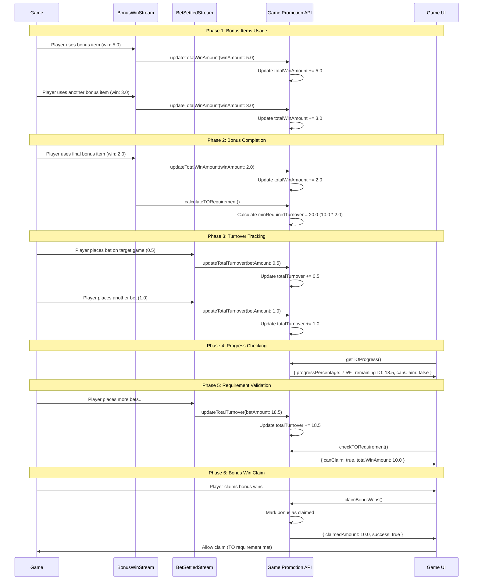

# TO Tracking APIs

This document describes the new APIs for tracking Turnover (TO) requirements in the promotion system, following the Turnover Tracking stream flow.

## Overview

The TO tracking system consists of six main APIs that work together to manage the turnover requirements for player promotions:

1. **updateTotalWinAmount** - Updates the total win amount from bonus items
2. **updateTotalTurnover** - Updates the total turnover from bets on target games
3. **calculateTORequirement** - Calculates the minimum required turnover after bonus completion
4. **checkTORequirement** - Validates if a player can claim bonus wins based on TO requirement
5. **getTOProgress** - Gets the current TO progress status for a player promotion
6. **claimBonusWins** - Claims bonus wins after TO requirement is met

## API Endpoints

### 1. Update Total Win Amount

**Endpoint:** `POST /player-promotions/update-total-win`

**Description:** Updates the total win amount for a player promotion. This is typically called by the BonusWin stream consumer when a bonus item is used.

**Request Body:**

```json
{
  "playerId": "player123",
  "operatorId": "op123",
  "siteName": "site456",
  "promotionId": "65f1a2b3c4d5e6f7g8h9i0j1",
  "winAmount": 5.0
}
```

**Response:**

```json
{
  "success": true,
  "totalWinAmount": 25.0
}
```

**Error Response:**

```json
{
  "success": false,
  "totalWinAmount": 0,
  "code": "SB3010",
  "message": "Failed to update total win amount"
}
```

### 2. Update Total Turnover

**Endpoint:** `POST /player-promotions/update-total-turnover`

**Description:** Updates the total turnover for a player promotion. This is typically called by the TurnoverConsumer when a bet is settled on the target game.

**Request Body:**

```json
{
  "playerId": "player123",
  "operatorId": "op123",
  "siteName": "site456",
  "promotionId": "65f1a2b3c4d5e6f7g8h9i0j1",
  "betAmount": 0.5
}
```

**Response:**

```json
{
  "success": true,
  "totalTurnover": 15.5,
  "remainingTO": 34.5
}
```

**Error Response:**

```json
{
  "success": false,
  "totalTurnover": 0,
  "remainingTO": 0,
  "code": "SB3014",
  "message": "Failed to update total turnover"
}
```

### 3. Calculate TO Requirement

**Endpoint:** `POST /player-promotions/calculate-to-requirement`

**Description:** Calculates the minimum required turnover for a player promotion. This is typically called by the BonusWinConsumer when all bonus items are completed.

**Request Body:**

```json
{
  "playerId": "player123",
  "operatorId": "op123",
  "siteName": "site456",
  "promotionId": "65f1a2b3c4d5e6f7g8h9i0j1"
}
```

**Response:**

```json
{
  "success": true,
  "minRequiredTurnover": 50.0,
  "totalWinAmount": 25.0,
  "turnoverMultiplier": 2.0
}
```

**Error Response (Bonus Not Completed):**

```json
{
  "success": false,
  "minRequiredTurnover": 0,
  "totalWinAmount": 15.0,
  "turnoverMultiplier": 0,
  "code": "SB3006",
  "message": "All bonus items must be completed before calculating TO requirement"
}
```

### 4. Check TO Requirement

**Endpoint:** `POST /player-promotions/check-to-requirement`

**Description:** Validates if a player can claim bonus wins based on the current TO requirement status. This is typically called before allowing a player to claim their bonus wins.

**Request Body:**

```json
{
  "playerId": "player123",
  "operatorId": "op123",
  "siteName": "site456",
  "promotionId": "65f1a2b3c4d5e6f7g8h9i0j1"
}
```

**Response (Can Claim):**

```json
{
  "success": true,
  "canClaim": true,
  "totalTurnover": 100.0,
  "minRequiredTurnover": 100.0,
  "remainingTO": 0,
  "totalWinAmount": 50.0
}
```

**Response (Cannot Claim):**

```json
{
  "success": true,
  "canClaim": false,
  "totalTurnover": 40.0,
  "minRequiredTurnover": 100.0,
  "remainingTO": 60.0,
  "totalWinAmount": 20.0
}
```

**Error Response (Player Promotion Not Found):**

```json
{
  "success": false,
  "canClaim": false,
  "totalTurnover": 0,
  "minRequiredTurnover": 0,
  "remainingTO": 0,
  "totalWinAmount": 0,
  "code": "SB3000",
  "message": "Player promotion not found"
}
```

### 5. Get TO Progress

**Endpoint:** `POST /player-promotions/get-to-progress`

**Description:** Gets the current TO progress status for a player promotion, including progress percentage and claimability status. This is typically used for UI display and progress tracking.

**Request Body:**

```json
{
  "playerId": "player123",
  "operatorId": "op123",
  "siteName": "site456",
  "promotionId": "65f1a2b3c4d5e6f7g8h9i0j1"
}
```

**Response:**

```json
{
  "success": true,
  "totalTurnover": 80.0,
  "minRequiredTurnover": 100.0,
  "remainingTO": 20.0,
  "progressPercentage": 80.0,
  "canClaim": false,
  "totalWinAmount": 30.0
}
```

**Error Response (Player Promotion Not Found):**

```json
{
  "success": false,
  "totalTurnover": 0,
  "minRequiredTurnover": 0,
  "remainingTO": 0,
  "progressPercentage": 0,
  "canClaim": false,
  "totalWinAmount": 0,
  "code": "SB3000",
  "message": "Player promotion not found"
}
```

### 6. Claim Bonus Wins

**Endpoint:** `POST /player-promotions/claim-bonus-wins`

**Description:** Claims bonus wins after TO requirement is met. This marks the bonus as claimed and returns the claimed amount. This is the final step in the TO tracking flow.

**Request Body:**

```json
{
  "playerId": "player123",
  "operatorId": "op123",
  "siteName": "site456",
  "promotionId": "65f1a2b3c4d5e6f7g8h9i0j1"
}
```

**Response (Success):**

```json
{
  "success": true,
  "claimedAmount": 25.0,
  "totalTurnover": 100.0,
  "minRequiredTurnover": 100.0,
  "totalWinAmount": 25.0
}
```

**Response (Any Failure):**

```json
{
  "success": false,
  "claimedAmount": 0,
  "totalTurnover": 0,
  "minRequiredTurnover": 0,
  "totalWinAmount": 0,
  "errorCode": "SB3017",
  "errorMessage": "Failed to claim bonus wins"
}
```

**Validation Conditions (MongoDB Query):**

- `remainingBonusItems: 0` - All bonus items must be completed
- `totalTurnover >= minRequiredTurnover` - TO requirement must be met
- `minRequiredTurnover > 0` - Must have valid TO requirement
- `totalWinAmount > 0` - Must have won something from bonus items
- `bonusClaimed != true` - Must not have been claimed already

## Stream Event Flow

### BonusWin Stream Consumer

```javascript
// Consumer for bonusWin events
class BonusWinConsumer {
  async consume(event) {
    const { playerId, operatorId, siteName, promotionId, winAmount } = event;

    // Update totalWinAmount
    await this.playerPromotionService.updateTotalWinAmount(
      playerId,
      operatorId,
      siteName,
      promotionId,
      winAmount,
    );

    // Check if all bonus items are completed
    const playerPromotion = await this.playerPromotionService.findByPromotion(
      playerId,
      operatorId,
      siteName,
      promotionId,
    );

    if (playerPromotion.remainingBonusItems === 0) {
      // Calculate TO requirement
      await this.playerPromotionService.calculateTORequirement(
        playerId,
        operatorId,
        siteName,
        promotionId,
      );
    }
  }
}
```

### Turnover Consumer

```javascript
// Consumer for bet.settled events
class TurnoverConsumer {
  async consume(event) {
    const { playerId, operatorId, siteName, promotionId, betAmount, gameId } = event;

    // Check if this is the target game for TO calculation
    const promotion = await this.promotionService.findById(promotionId);
    const targetGameId = promotion.gameIds[0]; // First game is target

    if (gameId === targetGameId) {
      // Update totalTurnover
      await this.playerPromotionService.updateTotalTurnover(
        playerId,
        operatorId,
        siteName,
        promotionId,
        betAmount,
      );
    }
  }
}
```

## Data Model Updates

### Player Promotion Schema

The player promotion schema has been updated to include the new TO tracking fields:

```typescript
export class PlayerPromotion {
  // ... existing fields ...

  @Prop({ type: Number, default: 0, required: true })
  totalWinAmount: number;

  @Prop({ type: Number, default: 0, required: true })
  totalTurnover: number;

  @Prop({ type: Number, default: 0, required: true })
  minRequiredTurnover: number;
}
```

### Example Player Promotion State

```json
{
  "playerId": "player123",
  "operatorId": "op123",
  "siteName": "site456",
  "promotionId": "65f1a2b3c4d5e6f7g8h9i0j1",
  "remainingBonusItems": 0,
  "initialBonusItem": 50,
  "betLevel": 0.2,
  "totalTurnover": 15.5,
  "totalWinAmount": 25.0,
  "minRequiredTurnover": 50.0,
  "lastUsedDate": "2024-06-15T10:30:00Z",
  "isGiftCode": false
}
```

## Error Codes

### New Error Codes Added

- **SB3005**: `TO_REQUIREMENT_NOT_MET` - Minimum turnover requirement not met
- **SB3006**: `BONUS_NOT_COMPLETED` - All bonus items must be completed before calculating TO requirement
- **SB3007**: `INVALID_TARGET_GAME` - Bet must be placed on target game for TO calculation
- **SB3008**: `STREAM_PROCESSING_ERROR` - Error processing stream event
- **SB3009**: `UPDATE_TOTAL_WIN_SUCCESS` - Total win amount updated successfully
- **SB3010**: `UPDATE_TOTAL_WIN_FAILED` - Failed to update total win amount
- **SB3011**: `CALCULATE_TO_SUCCESS` - TO requirement calculated successfully
- **SB3012**: `CALCULATE_TO_FAILED` - Failed to calculate TO requirement
- **SB3013**: `UPDATE_TOTAL_TO_SUCCESS` - Total turnover updated successfully
- **SB3014**: `UPDATE_TOTAL_TO_FAILED` - Failed to update total turnover
- **SB3016**: `BONUS_WIN_CLAIM_SUCCESS` - Bonus wins claimed successfully
- **SB3017**: `BONUS_WIN_CLAIM_FAILED` - Failed to claim bonus wins
- **SB3018**: `BONUS_ALREADY_CLAIMED` - Bonus wins have already been claimed
- **SB3019**: `TO_REQUIREMENT_NOT_ALLOWED` - System prevents claiming to avoid exploitation

## API Client Usage

### Using the GamePromotionApiClient

```typescript
import { GamePromotionApiClient } from './api-client';

const client = new GamePromotionApiClient({
  baseURL: 'http://localhost:3000',
  apiKey: 'your-api-key',
});

// Update total win amount
const winUpdate = await client.updateTotalWinAmount({
  playerId: 'player123',
  operatorId: 'op123',
  siteName: 'site456',
  promotionId: '65f1a2b3c4d5e6f7g8h9i0j1',
  winAmount: 5.0,
});

// Update total turnover
const turnoverUpdate = await client.updateTotalTurnover({
  playerId: 'player123',
  operatorId: 'op123',
  siteName: 'site456',
  promotionId: '65f1a2b3c4d5e6f7g8h9i0j1',
  betAmount: 0.5,
});

// Calculate TO requirement
const toRequirement = await client.calculateTORequirement({
  playerId: 'player123',
  operatorId: 'op123',
  siteName: 'site456',
  promotionId: '65f1a2b3c4d5e6f7g8h9i0j1',
});

// Check if player can claim bonus wins
const canClaim = await client.checkTORequirement({
  playerId: 'player123',
  operatorId: 'op123',
  siteName: 'site456',
  promotionId: '65f1a2b3c4d5e6f7g8h9i0j1',
});

if (canClaim.success && canClaim.canClaim) {
  console.log('Player can claim bonus wins!');
  console.log(`Total win amount: ${canClaim.totalWinAmount}`);
} else {
  console.log(`Need ${canClaim.remainingTO} more turnover to claim`);
}

// Get TO progress for UI display
const progress = await client.getTOProgress({
  playerId: 'player123',
  operatorId: 'op123',
  siteName: 'site456',
  promotionId: '65f1a2b3c4d5e6f7g8h9i0j1',
});

console.log(`Progress: ${progress.progressPercentage}%`);
console.log(`Remaining TO: ${progress.remainingTO}`);
console.log(`Can claim: ${progress.canClaim}`);

// Claim bonus wins after TO requirement is met
const claimResult = await client.claimBonusWins({
  playerId: 'player123',
  operatorId: 'op123',
  siteName: 'site456',
  promotionId: '65f1a2b3c4d5e6f7g8h9i0j1',
});

if (claimResult.success) {
  console.log(`Bonus wins claimed: ${claimResult.claimedAmount}`);
} else {
  console.log(`Cannot claim: ${claimResult.errorMessage}`);
}
```

## Validation Rules

1. **Bonus Completion Check**: TO requirement can only be calculated after all bonus items are completed
2. **Target Game Validation**: Only bets on the first game in gameIds array count toward TO requirement
3. **Minimum Multiplier**: All promotions must have at least 2.0X TO multiplier
4. **Security Protection**: `canClaim = false` when minRequiredTurnover = 0 (prevents exploitation)
5. **Atomic Updates**: All updates are performed atomically to prevent race conditions
6. **Error Handling**: Comprehensive error handling with specific error codes and messages

## TO Calculation Examples

### Example 1: Standard Promotion

- **Total Win Amount**: 25.00 (after completing all bonus items)
- **Min Turnover Multiplier**: 2.0X
- **Min Required TO**: 25.00 × 2.0 = 50.00
- **Target Game**: First game in gameIds array (e.g., Game ID 1001)

### Example 2: VIP Promotion

- **Total Win Amount**: 75.00 (after completing all bonus items)
- **Min Turnover Multiplier**: 3.0X
- **Min Required TO**: 75.00 × 3.0 = 225.00
- **Target Game**: First game in gameIds array (e.g., Game ID 1001)

### Example 3: Gift Code

- **Total Win Amount**: 4.00 (after completing all bonus items)
- **Min Turnover Multiplier**: 2.0X (minimum)
- **Min Required TO**: 4.00 × 2.0 = 8.00
- **Target Game**: First game in gameIds array (e.g., Game ID 2001)

### Example 4: No TO Required (minRequiredTurnover = 0)

- **Total Win Amount**: 10.00 (after completing all bonus items)
- **Min Turnover Multiplier**: 0.0X (no TO required)
- **Min Required TO**: 0.00
- **Behavior**: **Security Protected** - `canClaim = false` when minRequiredTurnover = 0
- **Result**: Player cannot claim bonus wins (prevents exploitation)

## Implementation Notes

1. **Stream Integration**: These APIs are designed to be called by stream consumers
2. **Real-time Updates**: TO progress is updated in real-time as bets are placed
3. **Target Game Specificity**: Only bets on the first game in gameIds array count toward TO requirement
4. **Bonus Completion**: TO requirement is only calculated after all bonus items are used
5. **Stream Resilience**: Implement retry logic and dead letter queues for failed stream processing
6. **Event Ordering**: Ensure proper ordering of events for accurate calculations
7. **Security Protection**: `canClaim = false` when minRequiredTurnover = 0 prevents exploitation
8. **Atomic Claims**: claimBonusWins uses MongoDB query conditions for atomic validation and update

## Testing

### Postman Collection

The new APIs are included in the updated Postman collection:

- `Game-Promotion-API-Complete-Flow.postman_collection.json`
- `Game-Promotion-API-Deduction-Verification.postman_collection.json`

### Test Scenarios

1. **Bonus Win Processing**: Test updating total win amount after each bonus item
2. **TO Calculation**: Test calculating TO requirement after bonus completion
3. **Turnover Tracking**: Test updating total turnover for target game bets
4. **TO Requirement Validation**: Test checking if player can claim bonus wins
5. **TO Progress Tracking**: Test getting progress status for UI display
6. **Bonus Win Claim**: Test claiming bonus wins after TO requirement is met
7. **Error Handling**: Test various error scenarios and edge cases
8. **Stream Integration**: Test integration with stream consumers

## Migration Notes

### Database Migration

Existing player promotions will have the new fields initialized to 0:

- `totalWinAmount`: 0
- `totalTurnover`: 0
- `minRequiredTurnover`: 0

### Backward Compatibility

The new APIs are additive and don't break existing functionality. All existing endpoints continue to work as before.

### Deployment

1. Deploy the updated schema and service changes
2. Update the API client with new methods
3. Configure stream consumers to use the new APIs
4. Monitor the system for any issues during the transition

## Complete TO Tracking Flow

### Typical Usage Scenario

Here's how all five APIs work together in a complete TO tracking scenario:



### API Usage Patterns

#### For Stream Consumers (Automated)

- `updateTotalWinAmount` - Called by BonusWinConsumer
- `updateTotalTurnover` - Called by TurnoverConsumer
- `calculateTORequirement` - Called by BonusWinConsumer when bonus completed

#### For Game UI (Manual/On-Demand)

- `checkTORequirement` - Called before allowing bonus win claim
- `getTOProgress` - Called for UI progress display
- `claimBonusWins` - Called when player claims bonus wins

#### For Monitoring/Debugging

- All APIs can be called manually for monitoring and debugging purposes
- Error responses provide detailed information for troubleshooting
