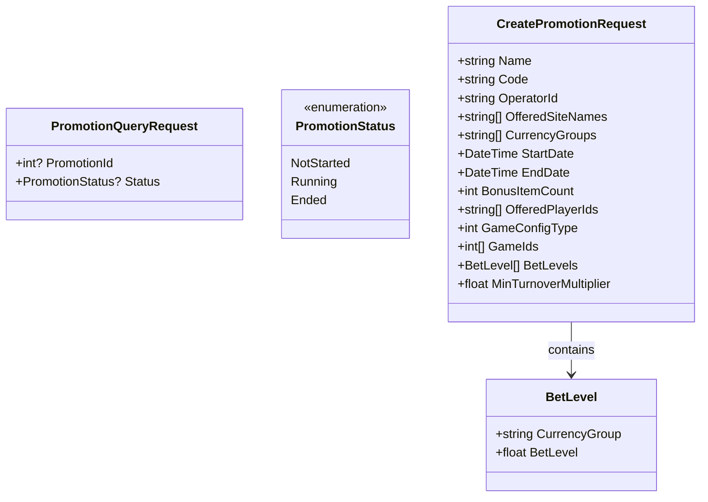
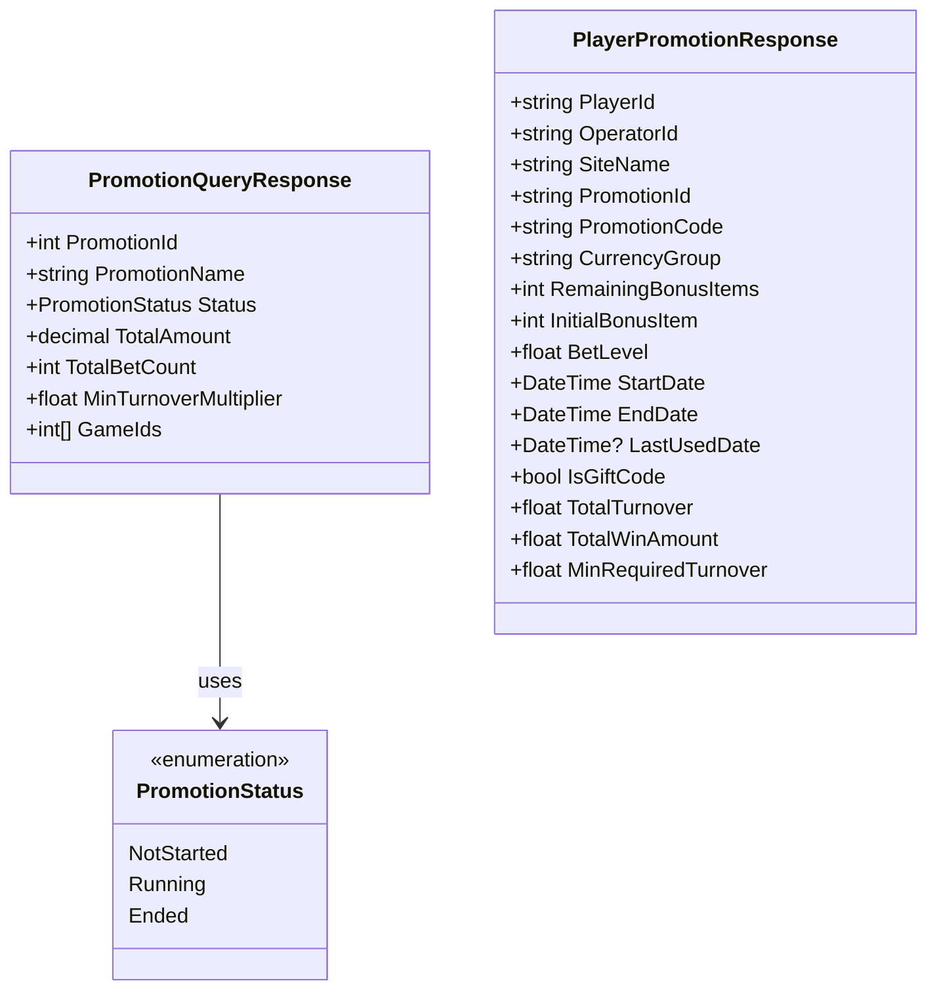

# Promotion API Endpoint

This diagram shows the structure and data model for the Promotion API endpoint.

## API Endpoint Structure

```mermaid
classDiagram
    class PromotionAPI {
        <<Controller>>
        +POST /api/promotion/query
        +POST /api/promotion/create
        +PUT /api/promotion/update
        +GET /api/promotion/{id}
        +PATCH /api/promotion/{id}/cancel
    }

    class PromotionQueryRequest {
        +int? PromotionId
        +PromotionStatus? Status
    }

    class PromotionStatus {
        <<enumeration>>
        NotStarted
        Running
        Ended
    }

    class PromotionQueryResponse {
        +int PromotionId
        +string PromotionName
        +PromotionStatus Status
        +decimal TotalAmount
        +int TotalBetCount
        +float MinTurnoverMultiplier
        +int[] GameIds
    }

    class CreatePromotionRequest {
        +string Name
        +string Code
        +string OperatorId
        +string[] OfferedSiteNames
        +string[] CurrencyGroups
        +DateTime StartDate
        +DateTime EndDate
        +int BonusItemCount
        +string[] OfferedPlayerIds
        +int GameConfigType
        +int[] GameIds
        +BetLevel[] BetLevels
        +float MinTurnoverMultiplier
    }

    class BetLevel {
        +string CurrencyGroup
        +float BetLevel
    }

    PromotionAPI --> PromotionQueryRequest : accepts
    PromotionAPI --> PromotionQueryResponse : returns
    PromotionAPI --> CreatePromotionRequest : accepts
    PromotionQueryRequest --> PromotionStatus : uses
    PromotionQueryResponse --> PromotionStatus : uses
    CreatePromotionRequest --> BetLevel : contains
```

## Request Model



## Response Model



## Description

### Endpoint Details

- **Method**: POST
- **Path**: `/api/promotion/query`
- **Purpose**: Query promotion statistics and details

### Request Parameters

- **PromotionId** (optional): Filter by specific promotion ID
- **Status** (optional): Filter by promotion status
  - NotStarted: Promotion has not begun
  - Running: Promotion is currently active
  - Ended: Promotion has completed

### Response Data

- **PromotionId**: Unique identifier of the promotion
- **PromotionName**: Display name of the promotion
- **Status**: Current status of the promotion
- **TotalAmount**: Total bet amount for the promotion
- **TotalBetCount**: Total number of bets placed
- **MinTurnoverMultiplier**: Minimum TO multiplier required (at least 2.0X)
- **GameIds**: Array of eligible game IDs (first game is target for TO calculation)

### Usage Example

#### Query Promotions

```http
POST /api/promotion/query
Content-Type: application/json

{
    "promotionId": 123,
    "status": "Running"
}
```

Response:

```json
{
  "promotionId": 123,
  "promotionName": "Summer Special 2024",
  "status": "Running",
  "totalAmount": 15000.5,
  "totalBetCount": 250,
  "minTurnoverMultiplier": 2.5,
  "gameIds": [1001, 1002]
}
```

#### Create Promotion

```http
POST /api/promotion/create
Content-Type: application/json

{
    "name": "VIP Classic Free Spins",
    "code": "vip-classic-free-spins",
    "operatorId": "op123",
    "offeredSiteNames": ["site456"],
    "currencyGroups": ["60d21b4667d0d01ce67a7e3b"],
    "startDate": "2024-06-15T00:00:00Z",
    "endDate": "2024-06-30T23:59:59Z",
    "bonusItemCount": 100,
    "offeredPlayerIds": ["player123", "player456"],
    "gameConfigType": 2,
    "gameIds": [1001],
    "betLevels": [
        {
            "currencyGroup": "60d21b4667d0d01ce67a7e3b",
            "betLevel": 0.25
        }
    ],
    "minTurnoverMultiplier": 2.0
}
```

#### Cancel Promotion

```http
PATCH /promotions/:id/cancel
Content-Type: application/json

{
    "adminUserId": "admin123"
}
```

Response:

```json
{
  "success": true,
  "code": "PR3103",
  "message": "Promotion has been successfully cancelled",
  "data": {
    "promotionId": "65f1a2b3c4d5e6f7g8h9i0j1",
    "promotionCode": "vip-classic-free-spins",
    "originalEndDate": "2024-06-30T23:59:59.000Z",
    "newEndDate": "2024-06-20T14:30:00.000Z",
    "cancelledAt": "2024-06-20T14:30:00.000Z",
    "adminUserId": "admin123"
  }
}
```

**Purpose**: Immediately terminates a running promotion by updating its end date and claim expiration date to the current timestamp. This operation is irreversible and creates an audit log entry.

**Request Body**:
- **adminUserId** (required): Admin user ID performing the cancellation for audit trail

**Response Data**:
- **promotionId**: Cancelled promotion ID
- **promotionCode**: Promotion code
- **originalEndDate**: Original scheduled end date
- **newEndDate**: New end date (cancellation timestamp)
- **cancelledAt**: Timestamp when cancellation occurred
- **adminUserId**: Admin user who performed cancellation

**Error Codes**:
- `PR3100` (404): Promotion not found
- `PR3103` (200): Cancellation successful
- `PR3104` (500): Cancellation failed
- `PR3105` (400): Invalid promotion status for cancellation

#### Player Promotion Response

```http
GET /api/player-promotions/claim-promotion
Content-Type: application/json

{
    "playerId": "player123",
    "operatorId": "op123",
    "siteName": "site456",
    "currencyGroup": "EUR"
}
```

Response:

```json
{
  "promotion": {
    "playerId": "player123",
    "operatorId": "op123",
    "siteName": "site456",
    "promotionId": "65f1a2b3c4d5e6f7g8h9i0j1",
    "promotionCode": "vip-classic-free-spins",
    "currencyGroup": "60d21b4667d0d01ce67a7e3b",
    "remainingBonusItems": 100,
    "initialBonusItem": 100,
    "betLevel": 0.25,
    "startDate": "2024-06-15T00:00:00Z",
    "endDate": "2024-06-30T23:59:59Z",
    "lastUsedDate": null,
    "isGiftCode": false,
    "totalTurnover": 0.0,
    "totalWinAmount": 0.0,
    "minRequiredTurnover": 0.0
  }
}
```

#### Player Promotion After Bonus Completion

```http
GET /api/player-promotions/claim-promotion
Content-Type: application/json

{
    "playerId": "player123",
    "operatorId": "op123",
    "siteName": "site456",
    "currencyGroup": "EUR"
}
```

Response:

```json
{
  "promotion": {
    "playerId": "player123",
    "operatorId": "op123",
    "siteName": "site456",
    "promotionId": "65f1a2b3c4d5e6f7g8h9i0j1",
    "promotionCode": "vip-classic-free-spins",
    "currencyGroup": "60d21b4667d0d01ce67a7e3b",
    "remainingBonusItems": 0,
    "initialBonusItem": 100,
    "betLevel": 0.25,
    "startDate": "2024-06-15T00:00:00Z",
    "endDate": "2024-06-30T23:59:59Z",
    "lastUsedDate": "2024-06-20T15:30:00Z",
    "isGiftCode": false,
    "totalTurnover": 15.5,
    "totalWinAmount": 25.0,
    "minRequiredTurnover": 50.0
  }
}
```

## TO Requirement Validation

### TO Calculation

- **Formula**: `minRequiredTurnover = totalWinAmount * minTurnoverMultiplier`
- **Example**: totalWinAmount=25.00, multiplier=2.0 → minRequired=50.00

### TO Tracking

- **TotalTurnover**: Running total of bet amounts placed on target game
- **Update**: Incremented after each bet placement on target game
- **Validation**: Bonus wins can only be claimed when totalTurnover >= minRequiredTurnover
- **Target Game**: First game in the gameIds array is used as target for TO calculation
- **TotalWinAmount**: Total win amount from all bonus items (calculated after bonus completion)

### Error Responses

#### TO Requirement Not Met

```json
{
  "error": "TO_REQUIREMENT_NOT_MET",
  "message": "Minimum turnover requirement not met. Need 23.50 more bets on target game.",
  "details": {
    "currentTurnover": 26.5,
    "requiredTurnover": 50.0,
    "remainingTO": 23.5,
    "targetGameId": 1001,
    "totalWinAmount": 25.0
  }
}
```

#### Invalid Target Game

```json
{
  "error": "INVALID_TARGET_GAME",
  "message": "Bet must be placed on target game 1001 (first in gameIds array) for TO calculation.",
  "details": {
    "targetGameId": 1001,
    "betGameId": 1002
  }
}
```

#### Bonus Not Completed

```json
{
  "error": "BONUS_NOT_COMPLETED",
  "message": "All bonus items must be completed before calculating TO requirement.",
  "details": {
    "remainingBonusItems": 25,
    "totalBonusItems": 100
  }
}
```

## Notes

- Both query parameters are optional
- If neither parameter is provided, returns all promotions
- If both parameters are provided, applies AND logic
- Amounts are returned in the system's base currency
- Bet count includes all valid bets for the promotion
- Status in response reflects current state of the promotion
- PromotionName provides human-readable identification
- MinTurnoverMultiplier must be at least 2.0X
- First game in gameIds array is used as target game for TO calculation
- TO is calculated only from bets placed on the target game
- Bonus wins cannot be claimed until TO requirement is met
- TO requirement is calculated after all bonus items are completed
- TotalWinAmount is the sum of all win amounts from bonus items
