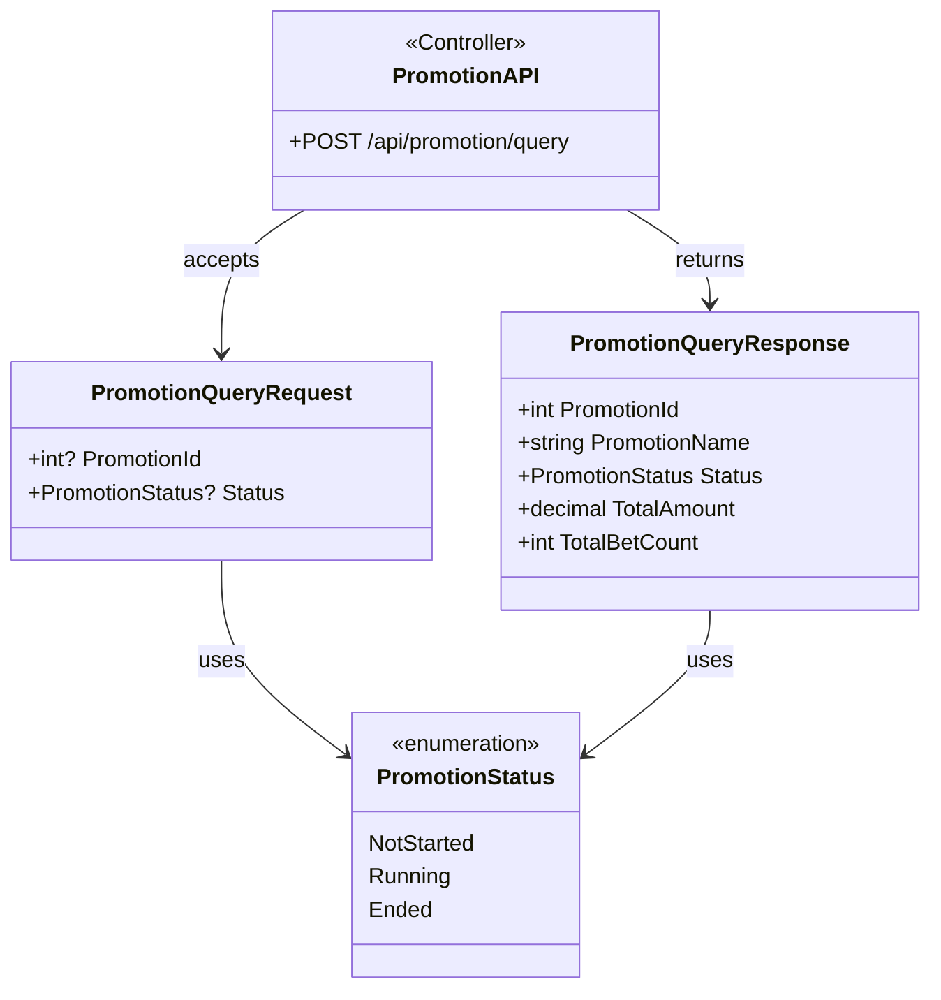
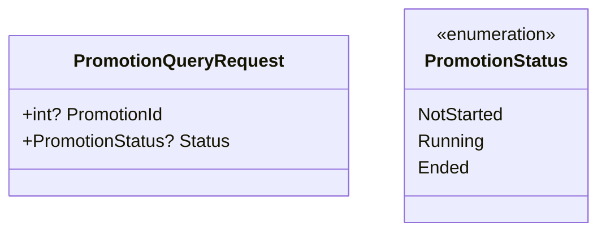
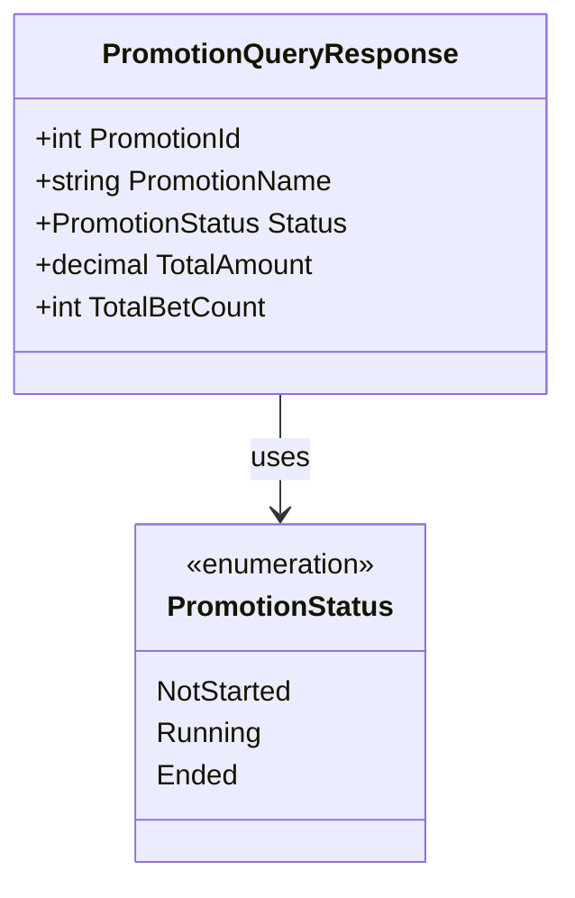

# Promotion API Endpoint

This diagram shows the structure and data model for the Promotion API endpoint.

## API Endpoint Structure



## Request Model



## Response Model



## Description

### Endpoint Details
- **Method**: POST
- **Path**: `/api/promotion/query`
- **Purpose**: Query promotion statistics and details

### Request Parameters
- **PromotionId** (optional): Filter by specific promotion ID
- **Status** (optional): Filter by promotion status
  - NotStarted: Promotion has not begun
  - Running: Promotion is currently active
  - Ended: Promotion has completed

### Response Data
- **PromotionId**: Unique identifier of the promotion
- **PromotionName**: Display name of the promotion
- **Status**: Current status of the promotion
- **TotalAmount**: Total bet amount for the promotion
- **TotalBetCount**: Total number of bets placed

### Usage Example

```http
POST /api/promotion/query
Content-Type: application/json

{
    "promotionId": 123,
    "status": "Running"
}
```

Response:
```json
{
    "promotionId": 123,
    "promotionName": "Summer Special 2024",
    "status": "Running",
    "totalAmount": 15000.50,
    "totalBetCount": 250
}
```

## Notes
- Both query parameters are optional
- If neither parameter is provided, returns all promotions
- If both parameters are provided, applies AND logic
- Amounts are returned in the system's base currency
- Bet count includes all valid bets for the promotion
- Status in response reflects current state of the promotion
- PromotionName provides human-readable identification 