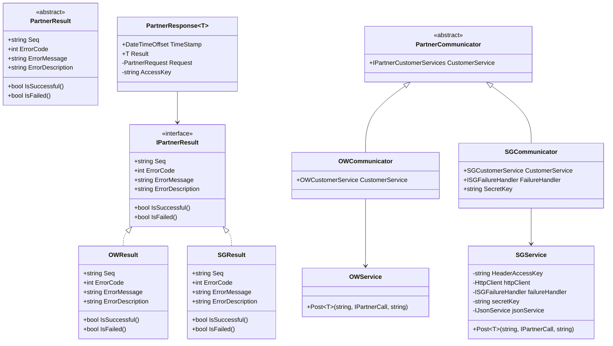
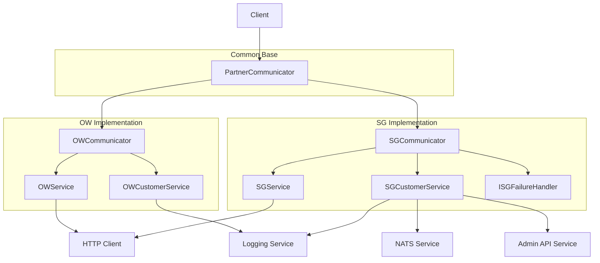

# Partner Communicators Architecture

This document describes the architecture of the Partner Communicators system, which handles communication with different gaming partners.

## Class Diagram

## Component Diagram

## Key Differences

### OWCommunicator
- Uses string-based `playerId`
- Direct implementation of `IPartnerResult`
- Standard HTTP communication
- Basic error handling

### SGCommunicator
- Uses integer-based `playerId`
- Custom authentication with `SG-access-key`
- Specialized error handling
- Additional features:
  - High-stake notifications
  - Retry policies
  - NATS integration
  - Admin API integration 