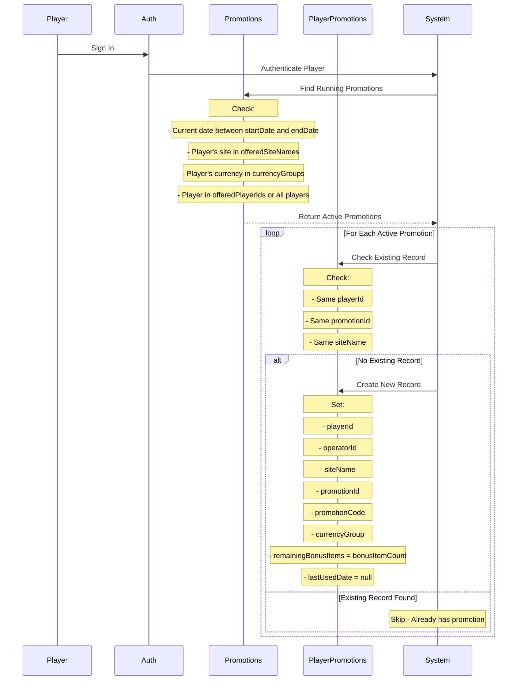
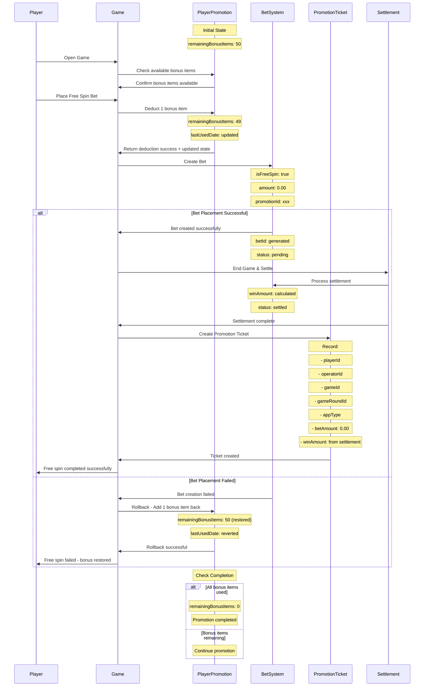
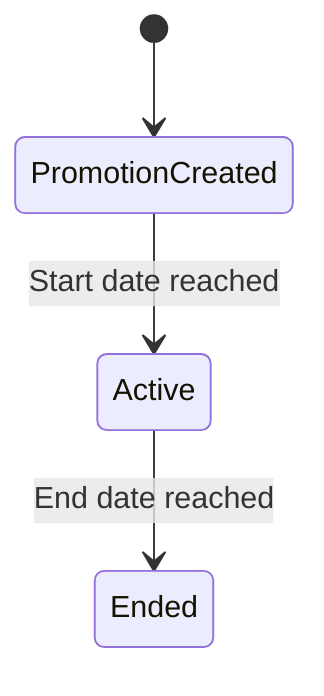
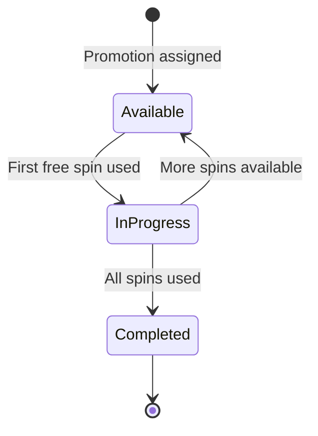
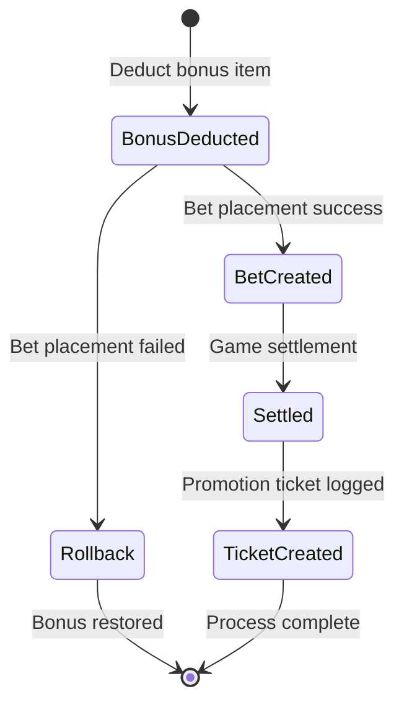

# Free Spin Count Deduction Flow

## Player Promotion Insertion Flow



## Updated Free Spin Deduction Flow (Robust with Rollback)



## New Service Methods Required

### PlayerPromotionService

```typescript
// New method for rollback functionality
async rollbackBonusItemDeduction(
  operatorId: string,
  playerId: string,
  promotionId: string
): Promise<RollbackResponse>

// Enhanced deduct method that returns previous state for rollback
async deductBonusItemWithRollbackData(
  operatorId: string,
  playerId: string,
  promotionId: string
): Promise<DeductWithRollbackResponse>
```

### PromotionTicketService

```typescript
// Create promotion ticket after settlement (uses standard createTicket method)
async createTicket(
  createTicketDto: CreatePromotionTicketDto
): Promise<CreatePromotionTicketResponse>
```

## State Transitions

### 1. Promotion Creation



### 2. Player Promotion States



### 3. Enhanced Free Spin Bet States



## Data Flow

1. **Pre-Bet Phase**:

   - Player opens game
   - Game checks available bonus items
   - Player initiates free spin

2. **Deduction Phase**:

   - Deduct bonus item BEFORE bet creation
   - Store rollback data for potential restoration

3. **Bet Phase**:

   - Attempt to create bet
   - If successful: proceed to settlement
   - If failed: rollback bonus deduction

4. **Settlement Phase**:

   - Process game result
   - Calculate win/loss amounts
   - Update bet status

5. **Tracking Phase**:
   - Create promotion ticket for analytics
   - Record all transaction details

## Example Scenarios

### 1. Successful Free Spin Flow

```javascript
// Step 1: Before deduction
PlayerPromotion: { remainingBonusItems: 50 }

// Step 2: After deduction (before bet)
PlayerPromotion: { remainingBonusItems: 49, lastUsedDate: "2024-06-01T11:00:00Z" }

// Step 3: After successful bet & settlement
Bet: { isFreeSpin: true, amount: 0.00, winAmount: 5.00, status: "settled" }
PromotionTicket: { playerId: "123", betAmount: 0.00, winAmount: 5.00 }
```

### 2. Failed Bet with Rollback

```javascript
// Step 1: Before deduction
PlayerPromotion: { remainingBonusItems: 50 }

// Step 2: After deduction
PlayerPromotion: { remainingBonusItems: 49, lastUsedDate: "2024-06-01T11:00:00Z" }

// Step 3: Bet fails, rollback triggered
PlayerPromotion: { remainingBonusItems: 50, lastUsedDate: null } // Restored
// No bet record created
// No promotion ticket created
```

## Validation Rules

1. **Pre-Deduction Validation**:

   - Check if player has available bonus items > 0
   - Verify game is eligible for promotion
   - Confirm promotion is active and within date range

2. **Deduction Validation**:

   - Atomic operation to prevent race conditions
   - Store previous state for rollback capability
   - Update lastUsedDate immediately

3. **Bet Creation Validation**:

   - Verify all game parameters
   - Ensure proper promotion reference
   - Set isFreeSpin = true, amount = 0.00

4. **Rollback Validation**:

   - Only allow rollback within same session
   - Verify rollback data integrity
   - Restore exact previous state

5. **Ticket Creation**:
   - Always create ticket after settlement
   - Record actual win/loss amounts
   - Include all relevant game metadata
