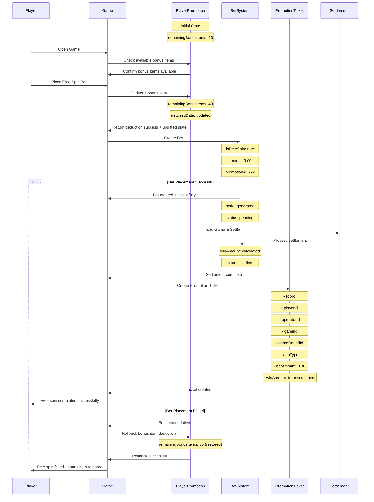
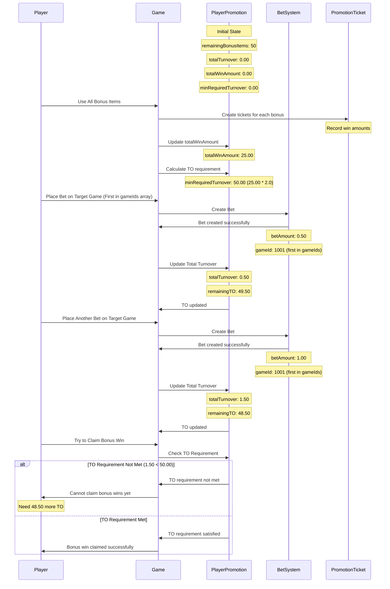
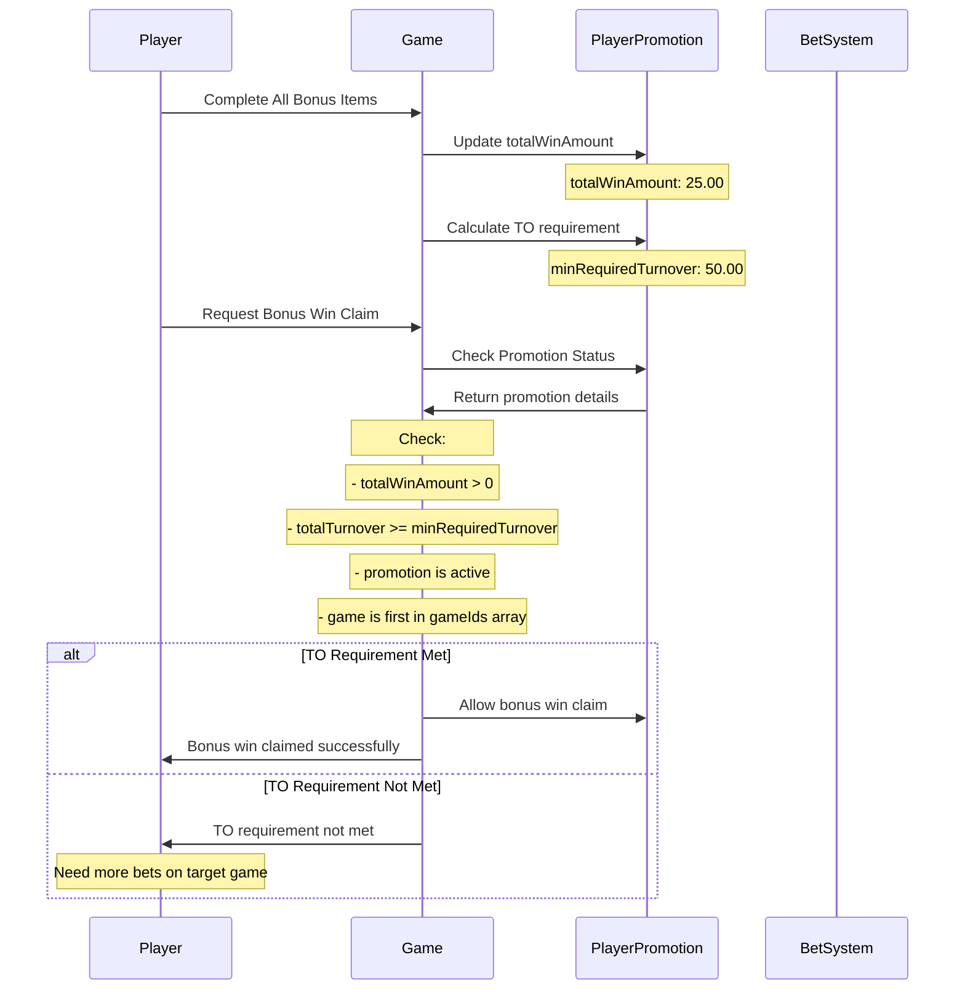

# FreeSpin Flow

This document describes the flow for handling free spins in the promotion system.

## Overview

Free spins are bonus items that allow players to play games without placing real money bets. The system tracks the usage of free spins and ensures proper validation and settlement.

## Flow Diagram



## TO Requirement Flow



## TO Requirement Validation Flow



## Data Models

### Player Promotion State

```javascript
{
    playerId: "player123",
    operatorId: "op123",
    siteName: "site456",
    promotionId: ObjectId("65f1a2b3c4d5e6f7g8h9i0j1"),
    remainingBonusItems: 0, // All bonus items used
    initialBonusItem: 50,
    betLevel: 0.20,
    totalTurnover: 15.50,        // Current TO amount
    totalWinAmount: 25.00,       // Total win from all bonus items
    minRequiredTurnover: 50.00,  // Required TO (25.00 * 2.0)
    lastUsedDate: ISODate("2024-06-15T10:30:00Z"),
    isGiftCode: false
}
```

### Promotion Configuration

```javascript
{
    _id: ObjectId("65f1a2b3c4d5e6f7g8h9i0j1"),
    name: "Summer Classic Free Spins",
    bonusItemCount: 50,
    betLevels: [
        {
            currencyGroup: ObjectId("EUR_123"),
            betLevel: 0.20
        }
    ],
    minTurnoverMultiplier: 2.0,  // 2X TO required
    gameIds: [1001, 1002],       // First game (1001) is target for TO calculation
}
```

## Validation Rules

1. **Bonus Item Availability**:

   - Check if player has available bonus items > 0
   - Verify game is eligible for promotion
   - Confirm promotion is active and within date range

2. **Deduction Validation**:

   - Atomic operation to prevent race conditions
   - Store previous state for rollback capability
   - Update lastUsedDate immediately

3. **Bet Creation Validation**:

   - Verify all game parameters
   - Ensure proper promotion reference
   - Set isFreeSpin = true, amount = 0.00

4. **Rollback Validation**:

   - Only allow rollback within same session
   - Verify rollback data integrity
   - Restore exact previous state

5. **Ticket Creation**:

   - Always create ticket after settlement
   - Record actual win/loss amounts
   - Include all relevant game metadata

6. **TO Requirement Validation**:
   - Check if totalTurnover >= minRequiredTurnover
   - Only count bets on first game in gameIds array
   - Update totalTurnover after each bet placement
   - Calculate minRequiredTurnover after bonus completion
   - Prevent bonus win claim if TO requirement not met

## TO Calculation Examples

### Example 1: Standard Promotion

- **Total Win Amount**: 25.00 (after completing all bonus items)
- **Min Turnover Multiplier**: 2.0X
- **Min Required TO**: 25.00 × 2.0 = 50.00
- **Target Game**: First game in gameIds array (e.g., Game ID 1001)

### Example 2: VIP Promotion

- **Total Win Amount**: 75.00 (after completing all bonus items)
- **Min Turnover Multiplier**: 3.0X
- **Min Required TO**: 75.00 × 3.0 = 225.00
- **Target Game**: First game in gameIds array (e.g., Game ID 1001)

### Example 3: Gift Code

- **Total Win Amount**: 4.00 (after completing all bonus items)
- **Min Turnover Multiplier**: 2.0X (minimum)
- **Min Required TO**: 4.00 × 2.0 = 8.00
- **Target Game**: First game in gameIds array (e.g., Game ID 2001)

## Error Handling

### TO Requirement Not Met

- **Error Code**: `TO_REQUIREMENT_NOT_MET`
- **Message**: "Minimum turnover requirement not met. Need {remainingTO} more bets on target game."
- **Action**: Player must place more bets on target game before claiming bonus wins

### Invalid Target Game

- **Error Code**: `INVALID_TARGET_GAME`
- **Message**: "Bet must be placed on target game {targetGameId} (first in gameIds array) for TO calculation."
- **Action**: Player must place bets on the correct target game

### Promotion Expired

- **Error Code**: `PROMOTION_EXPIRED`
- **Message**: "Promotion has expired. Cannot use remaining bonus items."
- **Action**: Promotion is no longer valid

### Bonus Not Completed

- **Error Code**: `BONUS_NOT_COMPLETED`
- **Message**: "All bonus items must be completed before calculating TO requirement."
- **Action**: Player must complete all bonus items first

## Implementation Notes

1. **TO Tracking**: Total turnover is updated atomically after each bet placement on the target game
2. **Win Amount Tracking**: Total win amount is calculated after all bonus items are completed
3. **TO Calculation**: TO requirement is calculated as totalWinAmount × minTurnoverMultiplier
4. **Game Specificity**: Only bets on the first game in gameIds array count toward TO requirement
5. **Minimum Multiplier**: All promotions must have at least 2.0X TO multiplier
6. **Real-time Updates**: TO progress is updated in real-time as bets are placed
7. **Target Game**: The first game in the gameIds array is always used as the target game for TO calculation
8. **Bonus Completion**: TO requirement is only calculated after all bonus items are used
