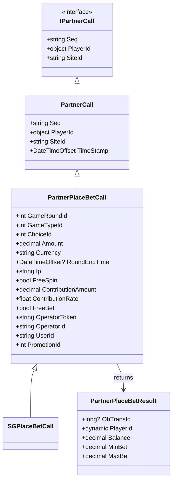

# PlaceBetCall Data Model

This diagram shows the class hierarchy and relationships for the PlaceBetCall system.

## Class Diagram

## Description

The PlaceBetCall system is designed to handle betting operations in the gaming platform. It follows a hierarchical structure:

1. **Base Interface**: `IPartnerCall` defines the basic contract for all partner calls
2. **Base Class**: `PartnerCall` implements the interface and adds timestamp functionality
3. **Betting Class**: `PartnerPlaceBetCall` extends the base class with betting-specific properties
4. **Implementation**: `SGPlaceBetCall` provides a specific implementation for the SG system

### Key Properties

- **Identification**: PlayerId, SiteId, Seq (sequence number)
- **Game Details**: GameRoundId, GameTypeId, ChoiceId
- **Financial**: Amount, Currency, ContributionAmount, ContributionRate
- **Special Features**: FreeSpin, FreeBet
- **Operator Info**: OperatorToken, OperatorId, UserId
- **Promotion**: PromotionId (links bet to specific promotion)
- **Result**: Returns a PartnerPlaceBetResult with transaction details and balance information

### Usage

This model is used in the betting workflow to:
1. Create new bets
2. Track bet details
3. Handle special bet types (free spins, free bets)
4. Link bets to specific promotions
5. Manage operator-specific implementations 