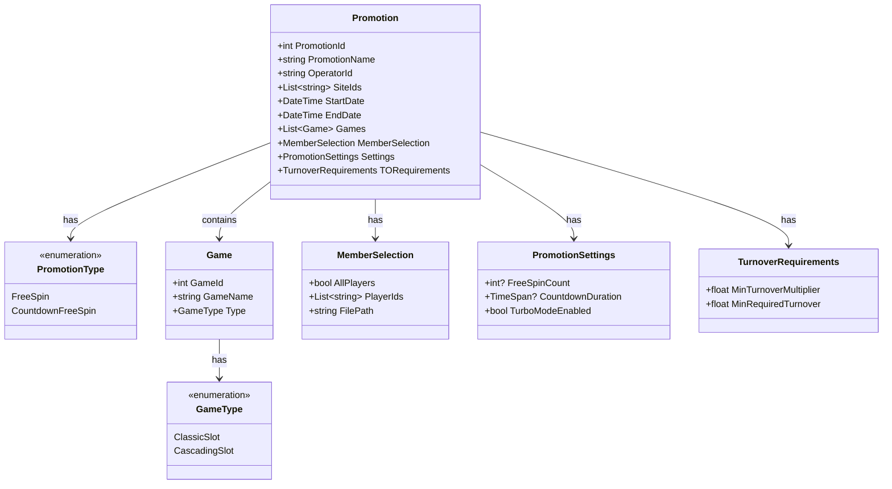
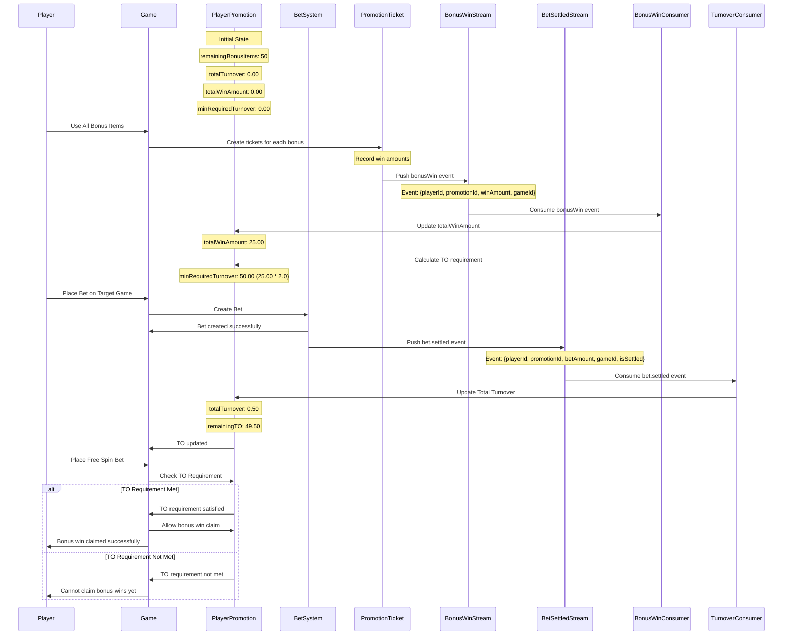
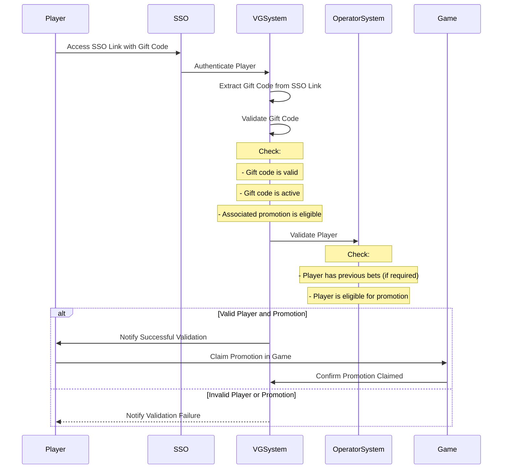
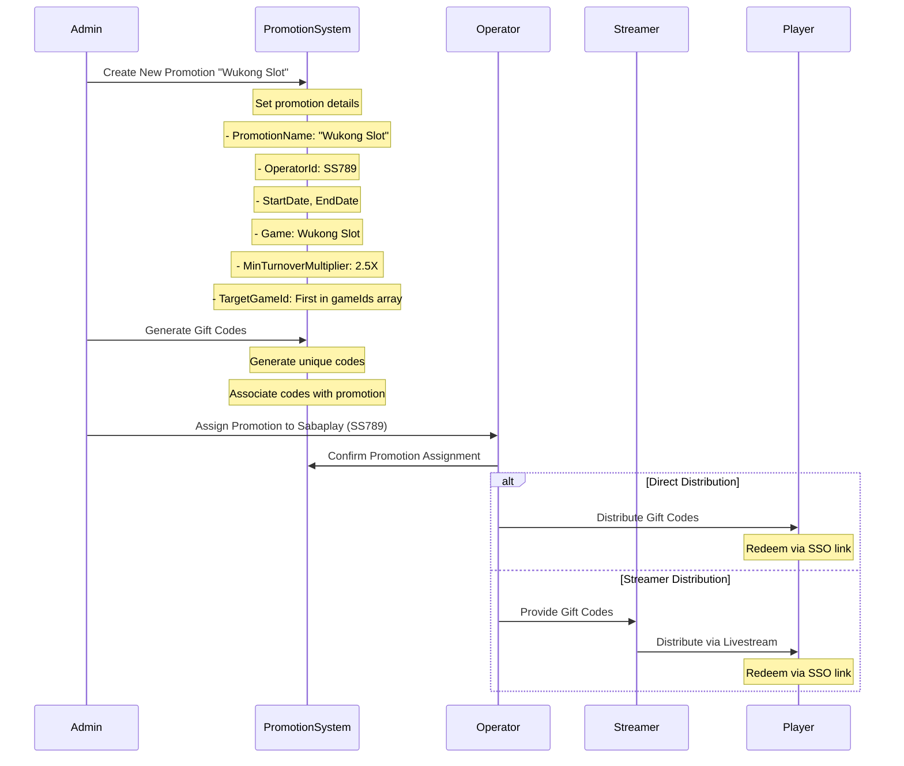

# Promotion Configuration

This diagram shows the structure and relationships for the Promotion Configuration system.

## Class Diagram



## Configuration Details

### Basic Information

- **PromotionName**: Required, unique identifier for the promotion
- **PromotionId**: System-generated unique identifier
- **OperatorId**: Required, operator identifier
- **SiteIds**: Required, list of site identifiers belonging to the operator
- **Type**:
  - FreeSpin: Standard free spins promotion
  - CountdownFreeSpin: Time-limited free spins promotion

### Time Settings

- **StartDate**:
  - Format: MM/DD/YYYY HH:MM (24h)
  - Must be before EndDate
- **EndDate**:
  - Format: MM/DD/YYYY HH:MM (24h)
  - Must be after StartDate
- **Overlap**: Multiple promotions can have overlapping time periods within same operator/site

### Game Configuration

- **GameType**:
  - ClassicSlot
  - CascadingSlot
- **Games**:
  - Selected from available games for the operator/site
  - Ordered by GameId
  - Games can't be in multiple active promotions simultaneously for same operator/site
  - **First game in the list is the target game for TO calculation**

### Member Selection

- **AllPlayers**:
  - If true, applies to all players in the operator/site
  - If false, uses PlayerIds list
- **PlayerIds**:
  - List of specific player IDs for the operator/site
  - Can be uploaded via file
- **FilePath**:
  - Optional path to player list file

### Promotion Settings

- **FreeSpinCount**:
  - Number of free spins per player
  - Only for FreeSpin type
- **CountdownDuration**:
  - Time limit for using free spins
  - Only for CountdownFreeSpin type
- **TurboModeEnabled**:
  - Allows turbo mode for CountdownFreeSpin
  - Only applicable to CountdownFreeSpin type

### Turnover Requirements

- **MinTurnoverMultiplier**:
  - Minimum TO multiplier required to claim bonus wins
  - Must be at least 2.0X (200%)
  - Example: 2.5X means player must bet 2.5 times the total win amount
- **Target Game**:
  - First game in the gameIds array is the target game for TO calculation
  - Current phase: one game only per promotion (first game in list)
  - TO is calculated only from bets placed on this specific game
- **MinRequiredTurnover**:
  - Calculated as: `totalWinAmount * minTurnoverMultiplier`
  - Example: totalWinAmount=25.00, multiplier=2.0 → minRequired=50.00
- **TotalTurnover**:
  - Running total of bet amounts placed on target game
  - Updated after each bet placement on target game
  - Used to track progress toward TO requirement
- **TotalWinAmount**:
  - Total win amount from all bonus items
  - Calculated after all bonus items are completed
  - Used as base for TO requirement calculation

### Access Control

- **Operator Level**:
  - Highest level of access control
  - Determines available sites and games
  - Controls promotion visibility
- **Site Level**:
  - Second level of access control
  - Determines available games
  - Controls player eligibility
- **Game Level**:
  - Third level of access control
  - Determines game availability
  - Controls promotion applicability
- **Player Level**:
  - Final level of access control
  - Determines individual eligibility
  - Controls promotion usage

## Validation Rules

1. EndDate must be after StartDate
2. FreeSpinCount required for FreeSpin type
3. CountdownDuration required for CountdownFreeSpin type
4. At least one game must be selected
5. Either AllPlayers must be true or PlayerIds must not be empty
6. PromotionName must be unique within operator
7. Games can't be in multiple active promotions for same operator/site
8. OperatorId must be valid and active
9. All SiteIds must belong to the operator
10. All sites must be active and valid
11. All games must be available for the operator/site
12. All players must be active in the operator/site
13. MinTurnoverMultiplier must be at least 2.0
14. First game in gameIds array is used as target game for TO calculation
15. TO requirement is calculated after bonus completion based on total win amount

## TO Requirement Flow



### Stream Event Models

#### BonusWin Event

```javascript
{
    eventType: "bonusWin",
    playerId: "player123",
    operatorId: "op123",
    siteName: "site456",
    promotionId: "65f1a2b3c4d5e6f7g8h9i0j1",
    gameId: 1001,
    gameRoundId: 789,
    winAmount: 5.00,
    betAmount: 0.00,
    timestamp: "2024-06-15T10:30:00Z",
    metadata: {
        isFreeSpin: true,
        promotionCode: "vip-classic-free-spins"
    }
}
```

#### BetSettled Event

```javascript
{
    eventType: "bet.settled",
    playerId: "player123",
    operatorId: "op123",
    siteName: "site456",
    promotionId: "65f1a2b3c4d5e6f7g8h9i0j1",
    gameId: 1001,
    gameRoundId: 790,
    betAmount: 0.50,
    winAmount: 0.00,
    timestamp: "2024-06-15T10:35:00Z",
    metadata: {
        isFreeSpin: false,
        isTargetGame: true
    }
}
```

### Event Consumer Implementation

#### BonusWin Consumer

```javascript
// Consumer for bonusWin events
class BonusWinConsumer {
  async consume(event) {
    const { playerId, operatorId, siteName, promotionId, winAmount } = event;

    // Update totalWinAmount
    await this.playerPromotionService.updateTotalWinAmount(
      playerId,
      operatorId,
      siteName,
      promotionId,
      winAmount,
    );

    // Check if all bonus items are completed
    const playerPromotion = await this.playerPromotionService.findByPromotion(
      playerId,
      operatorId,
      siteName,
      promotionId,
    );

    if (playerPromotion.remainingBonusItems === 0) {
      // Calculate TO requirement
      await this.playerPromotionService.calculateTORequirement(
        playerId,
        operatorId,
        siteName,
        promotionId,
      );
    }
  }
}
```

#### Turnover Consumer

```javascript
// Consumer for bet.settled events
class TurnoverConsumer {
  async consume(event) {
    const { playerId, operatorId, siteName, promotionId, betAmount, gameId } = event;

    // Check if this is the target game for TO calculation
    const promotion = await this.promotionService.findById(promotionId);
    const targetGameId = promotion.gameIds[0]; // First game is target

    if (gameId === targetGameId) {
      // Update totalTurnover
      await this.playerPromotionService.updateTotalTurnover(
        playerId,
        operatorId,
        siteName,
        promotionId,
        betAmount,
      );
    }
  }
}
```

### TO Calculation Examples

#### Example 1: Standard Promotion

- **Total Win Amount**: 25.00 (after completing all bonus items)
- **Min Turnover Multiplier**: 2.0X
- **Min Required TO**: 25.00 × 2.0 = 50.00
- **Target Game**: First game in gameIds array (e.g., Game ID 1001)

#### Example 2: VIP Promotion

- **Total Win Amount**: 75.00 (after completing all bonus items)
- **Min Turnover Multiplier**: 3.0X
- **Min Required TO**: 75.00 × 3.0 = 225.00
- **Target Game**: First game in gameIds array (e.g., Game ID 1001)

#### Example 3: Gift Code

- **Total Win Amount**: 4.00 (after completing all bonus items)
- **Min Turnover Multiplier**: 2.0X (minimum)
- **Min Required TO**: 4.00 × 2.0 = 8.00
- **Target Game**: First game in gameIds array (e.g., Game ID 2001)

## Updated Gift Code Redemption Flow with SSO



### Key Steps in the Updated Flow

1. **SSO Link Access**: The player accesses the SSO link, which includes the gift code as a parameter.
2. **Authentication**: The SSO service authenticates the player and passes the information to the VG system.
3. **Gift Code Extraction and Validation**: The VG system extracts the gift code from the SSO link and validates it to ensure it is valid, active, and associated with an eligible promotion.
4. **Player Validation**: The VG system communicates with the Operator system to validate the player. This includes checking if the player has previous bets (if required) and ensuring the player is eligible for the promotion.
5. **Promotion Claim**: If the player and promotion are valid, the player is notified of successful validation and can claim the promotion in the game. The game confirms the promotion has been claimed to the VG system.
6. **Validation Failure**: If the player or promotion validation fails, the player is notified of the failure.

### Implementation Considerations

- **Security**: Ensure that the SSO link and gift codes are secure to prevent unauthorized access.
- **Eligibility Checks**: Implement comprehensive checks to validate player eligibility, including any specific conditions like previous bets or single-use codes.
- **Concurrency**: Handle concurrent redemption attempts to prevent race conditions.
- **Logging**: Maintain logs for SSO access, gift code validation, and promotion claims for auditing and troubleshooting purposes.

This flow provides a structured approach for players to redeem promotions via gift codes, ensuring that all necessary validations are performed before allowing the player to claim the promotion in the game.

## Gift Code Distribution Flow



### Key Steps in the Flow

1. **Promotion Creation**:

   - The admin creates a new promotion in the system, specifying details such as the promotion name ("Wukong Slot"), operator ID (SS789), start and end dates, and the associated game.

2. **Gift Code Generation**:

   - The system generates unique gift codes for the promotion and associates them with the promotion details.

3. **Promotion Assignment**:

   - The admin assigns the promotion to the Sabaplay operator (SS789). The operator confirms the assignment in the system.

4. **Gift Code Distribution**:
   - **Direct Distribution**: The operator directly distributes the gift codes to specific players, who can redeem them via an SSO link.
   - **Streamer Distribution**: The operator provides the gift codes to a streamer, who distributes them to players via livestreaming. Players redeem the codes via an SSO link.

### Implementation Considerations

- **Security**: Ensure that gift codes are securely generated and distributed to prevent unauthorized access.
- **Tracking**: Implement tracking mechanisms to monitor which players have received and redeemed gift codes.
- **Scalability**: Ensure the system can handle large-scale distribution, especially during livestream events.
- **Logging**: Maintain logs for gift code generation, distribution, and redemption for auditing and troubleshooting purposes.

This flow provides a structured approach to distributing gift codes, allowing for both direct and indirect distribution methods.
