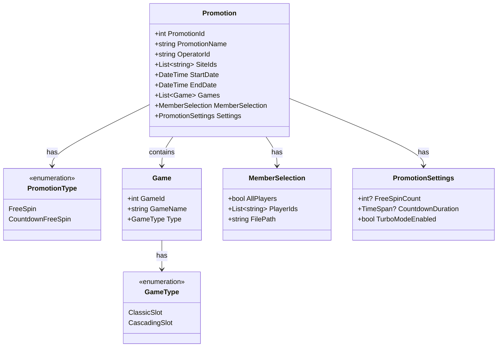

# Promotion Configuration

This diagram shows the structure and relationships for the Promotion Configuration system.

## Class Diagram

## Configuration Details

### Basic Information
- **PromotionName**: Required, unique identifier for the promotion
- **PromotionId**: System-generated unique identifier
- **OperatorId**: Required, operator identifier
- **SiteIds**: Required, list of site identifiers belonging to the operator
- **Type**: 
  - FreeSpin: Standard free spins promotion
  - CountdownFreeSpin: Time-limited free spins promotion

### Time Settings
- **StartDate**: 
  - Format: MM/DD/YYYY HH:MM (24h)
  - Must be before EndDate
- **EndDate**:
  - Format: MM/DD/YYYY HH:MM (24h)
  - Must be after StartDate
- **Overlap**: Multiple promotions can have overlapping time periods within same operator/site

### Game Configuration
- **GameType**:
  - ClassicSlot
  - CascadingSlot
- **Games**:
  - Selected from available games for the operator/site
  - Ordered by GameId
  - Games can't be in multiple active promotions simultaneously for same operator/site

### Member Selection
- **AllPlayers**: 
  - If true, applies to all players in the operator/site
  - If false, uses PlayerIds list
- **PlayerIds**:
  - List of specific player IDs for the operator/site
  - Can be uploaded via file
- **FilePath**:
  - Optional path to player list file

### Promotion Settings
- **FreeSpinCount**:
  - Number of free spins per player
  - Only for FreeSpin type
- **CountdownDuration**:
  - Time limit for using free spins
  - Only for CountdownFreeSpin type
- **TurboModeEnabled**:
  - Allows turbo mode for CountdownFreeSpin
  - Only applicable to CountdownFreeSpin type

### Access Control
- **Operator Level**:
  - Highest level of access control
  - Determines available sites and games
  - Controls promotion visibility
- **Site Level**:
  - Second level of access control
  - Determines available games
  - Controls player eligibility
- **Game Level**:
  - Third level of access control
  - Determines game availability
  - Controls promotion applicability
- **Player Level**:
  - Final level of access control
  - Determines individual eligibility
  - Controls promotion usage

## Validation Rules
1. EndDate must be after StartDate
2. FreeSpinCount required for FreeSpin type
3. CountdownDuration required for CountdownFreeSpin type
4. At least one game must be selected
5. Either AllPlayers must be true or PlayerIds must not be empty
6. PromotionName must be unique within operator
7. Games can't be in multiple active promotions for same operator/site
8. OperatorId must be valid and active
9. All SiteIds must belong to the operator
10. All sites must be active and valid
11. All games must be available for the operator/site
12. All players must be active in the operator/site 