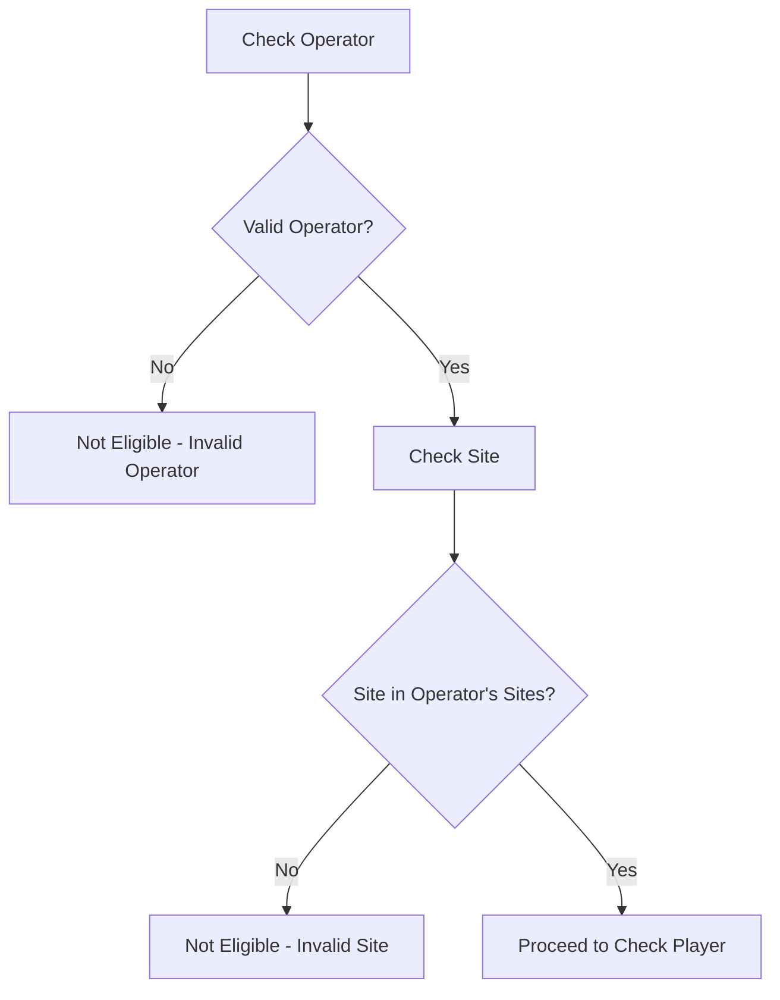
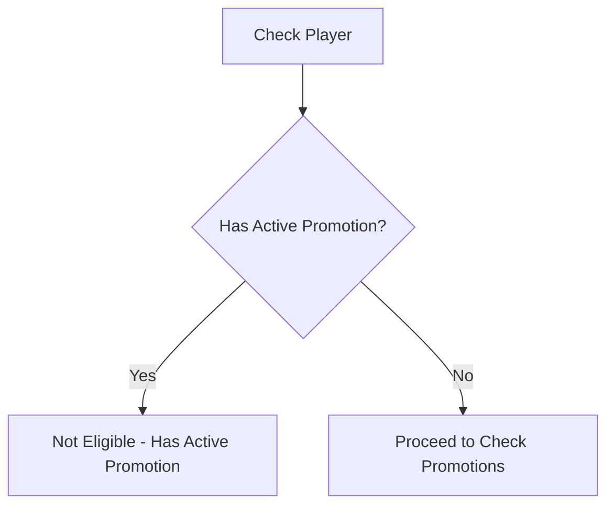
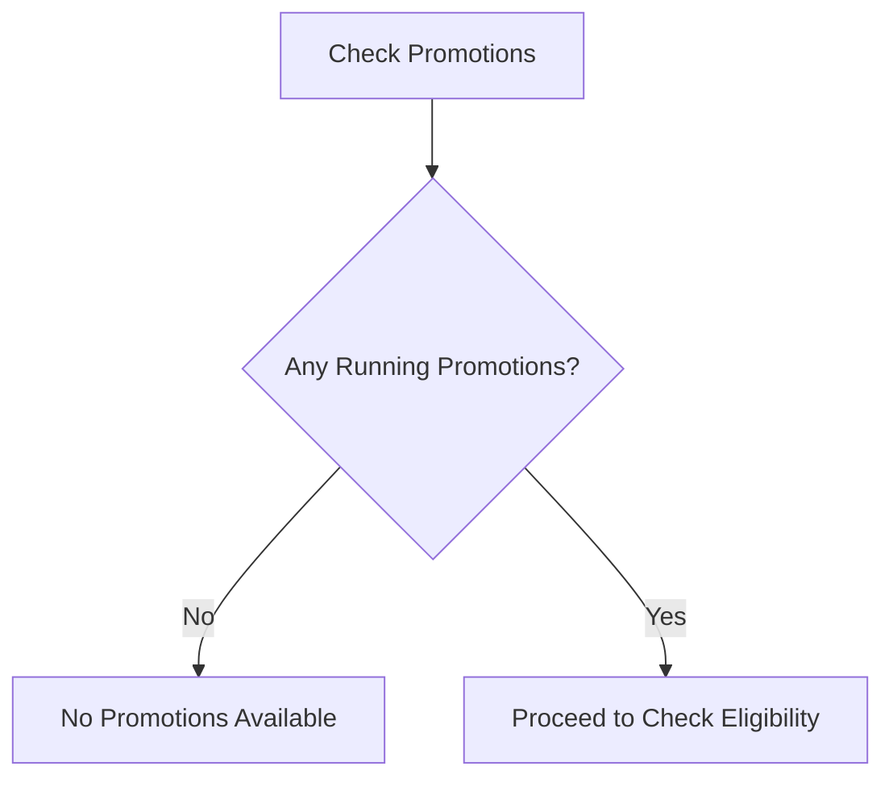
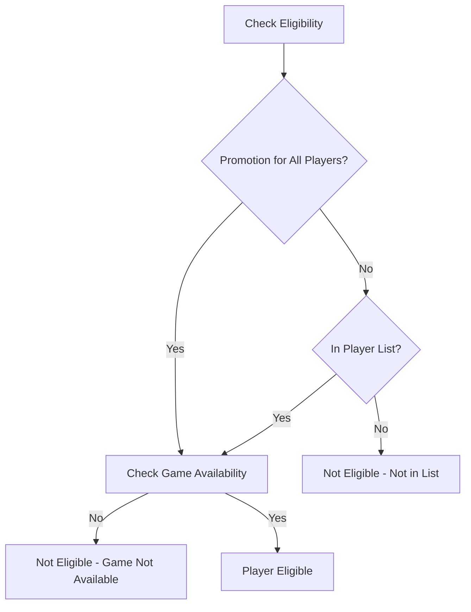
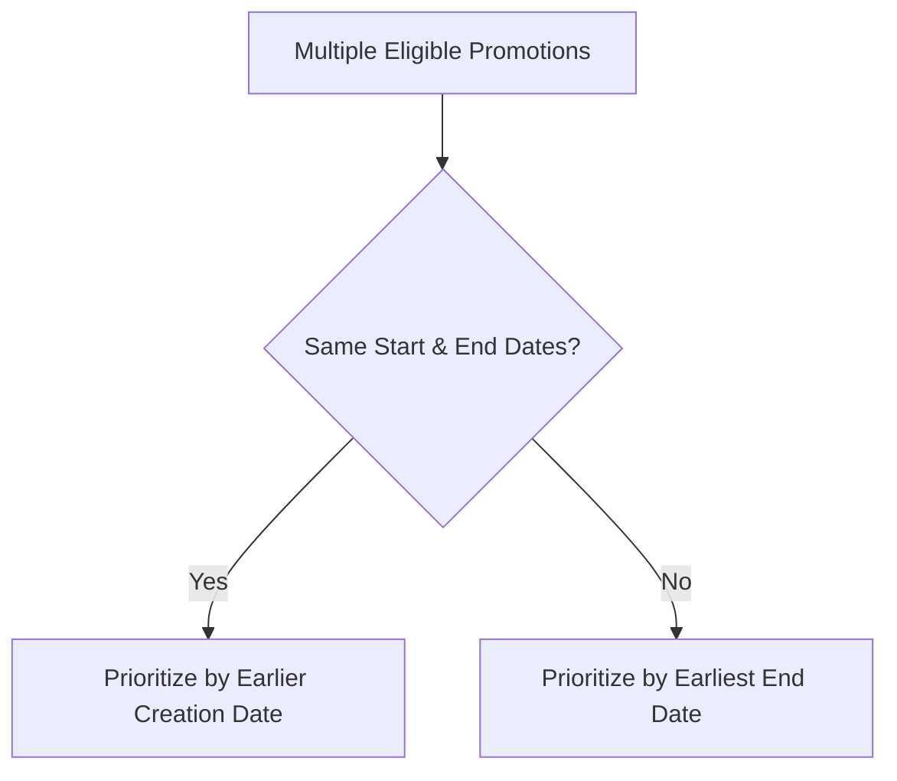

# FreeSpin Promotion Validation Rules

## Simplified Flow

### 1. Check Operator and Site

### 2. Check Player's Current Status

### 3. Check Available Promotions

### 4. Check Player Eligibility

### 5. Promotion Priority Sorting

## Key Rules

1. **Operator and Site Validation**

   - Operator must be valid and active
   - Site must belong to the operator
   - Site must be active and valid
   - Hierarchy: Operator > Site > Games > Player

2. **Player Can Only Have One Active Promotion**

   - If player has an active promotion, they are not eligible for new ones
   - Must complete current promotion before getting a new one
   - Active promotion must be for the same operator and site

3. **Promotion Must Be Running**

   - Check if promotion is between StartDate and EndDate
   - Only running promotions are available to players
   - Promotion must be available for the operator and site

4. **Promotion Priority Rules**

   - If two promotions have the same Start and End dates, the promotion with the earlier creation date (based on Promotion ID) will be displayed first
   - For all other cases where promotions overlap, the promotion with the earliest expiration date (End Date) will be suggested first
   - This consistent rule ensures players always get access to promotions that will expire soonest

5. **Player Must Be Eligible**

   - For "All Players" promotions: All players are eligible
   - For specific list promotions: Must be in the player list
   - Player must be active in the operator and site

6. **Game Must Be Available**
   - Game must be in promotion's game list
   - Game must be available to the player
   - Game must not be in other active promotions
   - Game must be available in the operator and site

## Common Scenarios

1. **Invalid Operator or Site**

   - Not eligible for any promotions
   - Must use valid operator and site credentials

2. **Player Has Active Promotion**

   - Not eligible for new promotions
   - Must complete current promotion first
   - Active promotion must be for same operator and site

3. **No Running Promotions**

   - No promotions available to any player
   - Check back when new promotions start
   - Check if operator/site has any promotions

4. **Player Not in List**

   - Not eligible for specific list promotions
   - May be eligible for "All Players" promotions
   - Must be active in operator and site

5. **Game Not Available**

   - Not eligible even if player is in list
   - Must wait for game to become available
   - Game must be available in operator and site

6. **Multiple Eligible Promotions**
   - Promotions are sorted according to the priority rules
   - Earlier creation date promotions are preferred for identical date ranges
   - Promotions ending sooner are always preferred in overlapping scenarios to ensure players don't miss expiring offers

## Implementation Notes

1. **Check Order**

   - First check operator and site validity
   - Then check player's current status
   - Then check available promotions
   - Finally check eligibility and game availability

2. **Error Messages**

   - Clear messages explaining why player is not eligible
   - Include specific reason (invalid operator/site, active promotion, not in list, game not available)
   - Provide guidance on how to resolve the issue

3. **Status Tracking**
   - Track operator and site validity
   - Track player's current promotion status
   - Track remaining spins
   - Track game availability
   - Track operator and site access rights
