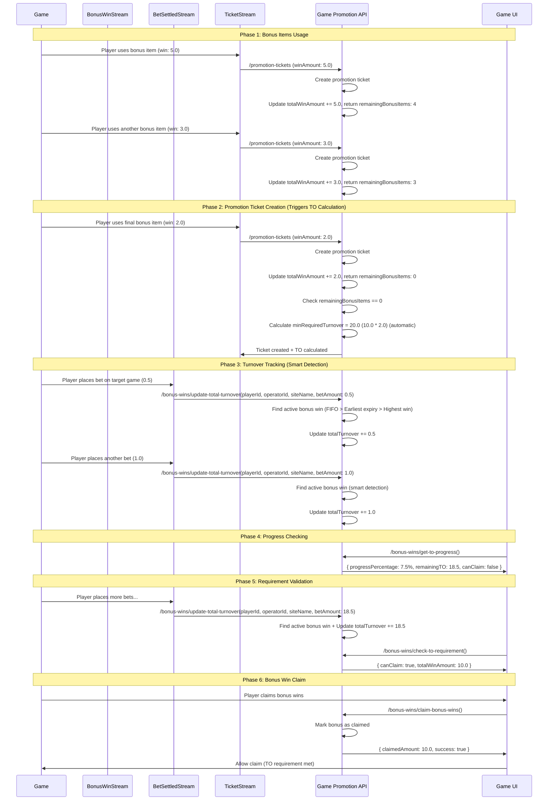

# Turnover Tracking Flow Sequence Diagram

This document shows the complete flow of the TO tracking system with all APIs working together, including automatic TO calculation after promotion ticket creation and smart bonus win detection for turnover tracking.

## Complete TO Tracking Flow

### Typical Usage Scenario

Here's how all APIs work together in a complete TO tracking scenario:



## API Usage Patterns

### For Stream Consumers (Automated)

- `/bonus-wins/update-total-turnover` - Called by TurnoverConsumer (bet settled streams)
  - **No promotionId required** - automatically finds active bonus win
  - Uses smart detection with FIFO > Earliest expiry > Highest win amount sorting
  - Tracks TO for all eligible games

### For Promotion Ticket Creation (Single Source of Truth)

- `/promotion-tickets` - **Single entry point** for TO tracking operations
- Automatically calls `updateTotalWinAmount` service method internally
- Automatically calls `calculateTORequirement` service method when remainingBonusItems = 0
- No external access to these operations - ensures data consistency

### For Game UI (Manual/On-Demand)

- `/bonus-wins/check-to-requirement` - Called before allowing bonus win claim
- `/bonus-wins/get-to-progress` - Called for UI progress display
- `/bonus-wins/claim-bonus-wins` - Called when player claims bonus wins

### For Monitoring/Debugging

- Available APIs can be called manually for monitoring and debugging purposes
- Error responses provide detailed information for troubleshooting

## Flow Phases

### Phase 1: Bonus Items Usage

- Player uses bonus items (free spins)
- Each bonus win creates a promotion ticket via `/promotion-tickets`
- Total win amount accumulates internally
- Service returns remainingBonusItems to avoid additional queries

### Phase 2: Promotion Ticket Creation (Triggers TO Calculation)

- Player uses final bonus item, creating a promotion ticket
- `/promotion-tickets` creates ticket and automatically updates total win amount
- When remainingBonusItems = 0, automatically calculates TO requirements
- Minimum required turnover is calculated based on total win amount and turnover multiplier

### Phase 3: Turnover Tracking (Smart Detection)

- Player places bets on target game
- Each bet settlement triggers `/bonus-wins/update-total-turnover` (no promotionId needed)
- **Smart bonus win detection** automatically finds the correct promotion to track:
  - Only finished promotions (`remainingBonusItems = 0`)
  - Only unclaimed bonuses (`bonusClaimed = false`)
  - Only promotions with TO requirements (`minRequiredTurnover > 0`)
  - **Sorting priority**: FIFO → Earliest expiry → Highest win amount
- Total turnover accumulates for the detected bonus win

### Phase 4: Progress Checking

- UI calls `/bonus-wins/get-to-progress` to show current status
- Progress percentage and remaining TO are displayed

### Phase 5: Requirement Validation

- Player continues placing bets until TO requirement is met
- `/bonus-wins/check-to-requirement` validates if claiming is allowed

### Phase 6: Bonus Win Claim

- Player claims bonus wins via `/bonus-wins/claim-bonus-wins`
- Bonus is marked as claimed atomically
- Claimed amount is returned

## Key Features

### Core Functionality

- **Atomic Operations**: All updates are performed atomically
- **Real-time Updates**: TO progress updates in real-time
- **Automatic TO Calculation**: TO requirements calculated automatically when bonus items exhausted
- **Single Source of Truth**: All TO tracking operations go through promotion ticket creation

### Smart Bonus Win Detection (New)

- **No PromotionId Required**: Bet settled streams don't need to specify which promotion to track
- **Intelligent Auto-Detection**: Automatically finds the correct bonus win to track turnover for
- **FIFO Processing**: First-in-first-out processing ensures fair order
- **Priority Sorting**: FIFO → Earliest expiry → Highest win amount
- **Multiple Promotion Support**: Handles players with multiple finished promotions correctly

### Stream Integration & Performance

- **Stream-Optimized**: Designed specifically for stream consumer integration
- **Efficient Data Flow**: Minimal database queries with smart detection
- **Comprehensive Validation**: All conditions checked in optimized MongoDB queries
- **Error Handling**: Graceful handling of edge cases (no active bonus wins, etc.)

### Security & Data Integrity

- **Security Protection**: Prevents exploitation when minRequiredTurnover = 0
- **Data Consistency**: Smart detection ensures correct promotion tracking
- **Validation Logic**: Only tracks TO for eligible finished promotions
- **Type Safety**: Full TypeScript support with proper error codes

## API Changes (v2.0)

### Updated Endpoints

#### `/bonus-wins/update-total-turnover` (UPDATED)

**Before:**

```json
{
  "playerId": "string",
  "operatorId": "string",
  "siteName": "string",
  "promotionId": "string", // ❌ Required
  "betAmount": "number"
}
```

**After:**

```json
{
  "playerId": "string",
  "operatorId": "string",
  "siteName": "string",
  "betAmount": "number" // ✅ No promotionId needed
}
```

### Smart Detection Logic

The API now automatically finds the active bonus win using this logic:

1. **Filter Criteria:**
   - `remainingBonusItems = 0` (promotion finished)
   - `bonusClaimed = false` (bonus not claimed yet)
   - `minRequiredTurnover > 0` (has TO requirement)
   - Active date range (`startDate <= now < endDate`)

2. **Sorting Priority:**
   - **Primary**: `createdAt ASC` (FIFO - First In, First Out)
   - **Secondary**: `endDate ASC` (Earliest expiry first)
   - **Tertiary**: `totalWinAmount DESC` (Highest win amount)

### Error Handling

#### New Error Code: `NO_ACTIVE_BONUS_WIN`

```json
{
  "success": false,
  "code": "SB3022",
  "message": "No active bonus win found for turnover tracking",
  "totalTurnover": 0,
  "remainingTO": 0
}
```

**When this occurs:**

- Player has no finished promotions waiting for TO tracking
- All eligible promotions have already been claimed
- All promotions have `minRequiredTurnover = 0` (no TO requirement)

### Migration Notes

#### For Stream Consumers

- **Remove `promotionId`** from `UpdateTotalTurnoverDto`
- **Keep all other fields** unchanged
- **Error handling** remains the same (check `success` field)
- **New error case** to handle: `NO_ACTIVE_BONUS_WIN`

#### For Game Integration

- **No changes required** for promotion ticket creation
- **No changes required** for bonus win claiming
- **No changes required** for progress checking
- Stream integration becomes **simpler** (no need to track promotionId)
