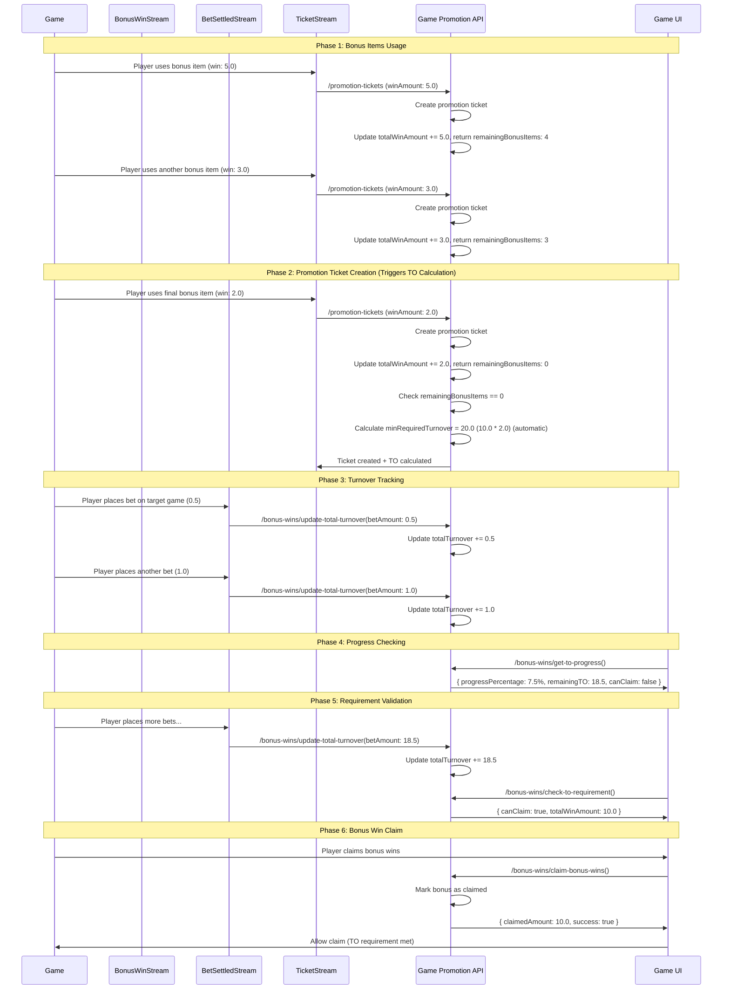

# Turnover Tracking Flow Sequence Diagram

This document shows the complete flow of the TO tracking system with all APIs working together, including automatic TO calculation after promotion ticket creation.

## Complete TO Tracking Flow

### Typical Usage Scenario

Here's how all APIs work together in a complete TO tracking scenario:

## API Usage Patterns

### For Stream Consumers (Automated)

- `/bonus-wins/update-total-turnover` - Called by TurnoverConsumer

### For Promotion Ticket Creation (Single Source of Truth)

- `/promotion-tickets` - **Single entry point** for TO tracking operations
- Automatically calls `updateTotalWinAmount` service method internally
- Automatically calls `calculateTORequirement` service method when remainingBonusItems = 0
- No external access to these operations - ensures data consistency

### For Game UI (Manual/On-Demand)

- `/bonus-wins/check-to-requirement` - Called before allowing bonus win claim
- `/bonus-wins/get-to-progress` - Called for UI progress display
- `/bonus-wins/claim-bonus-wins` - Called when player claims bonus wins

### For Monitoring/Debugging

- Available APIs can be called manually for monitoring and debugging purposes
- Error responses provide detailed information for troubleshooting

## Flow Phases

### Phase 1: Bonus Items Usage

- Player uses bonus items (free spins)
- Each bonus win creates a promotion ticket via `/promotion-tickets`
- Total win amount accumulates internally
- Service returns remainingBonusItems to avoid additional queries

### Phase 2: Promotion Ticket Creation (Triggers TO Calculation)

- Player uses final bonus item, creating a promotion ticket
- `/promotion-tickets` creates ticket and automatically updates total win amount
- When remainingBonusItems = 0, automatically calculates TO requirements
- Minimum required turnover is calculated based on total win amount and turnover multiplier

### Phase 3: Turnover Tracking

- Player places bets on target game
- Each bet settlement triggers `/bonus-wins/update-total-turnover`
- Total turnover accumulates

### Phase 4: Progress Checking

- UI calls `/bonus-wins/get-to-progress` to show current status
- Progress percentage and remaining TO are displayed

### Phase 5: Requirement Validation

- Player continues placing bets until TO requirement is met
- `/bonus-wins/check-to-requirement` validates if claiming is allowed

### Phase 6: Bonus Win Claim

- Player claims bonus wins via `/bonus-wins/claim-bonus-wins`
- Bonus is marked as claimed atomically
- Claimed amount is returned

## Key Features

- **Atomic Operations**: All updates are performed atomically
- **Real-time Updates**: TO progress updates in real-time
- **Security Protection**: Prevents exploitation when minRequiredTurnover = 0
- **Stream Integration**: Designed for stream consumer integration
- **Comprehensive Validation**: All conditions checked in MongoDB query
- **Automatic TO Calculation**: TO requirements calculated automatically when bonus items exhausted
- **Efficient Data Flow**: remainingBonusItems returned from updateTotalWinAmount to avoid additional queries
- **Promotion Ticket Integration**: Seamless integration between promotion tickets and TO tracking
- **Single Source of Truth**: All TO tracking operations go through promotion ticket creation
- **Data Consistency**: No external access to internal TO calculation methods ensures consistency
