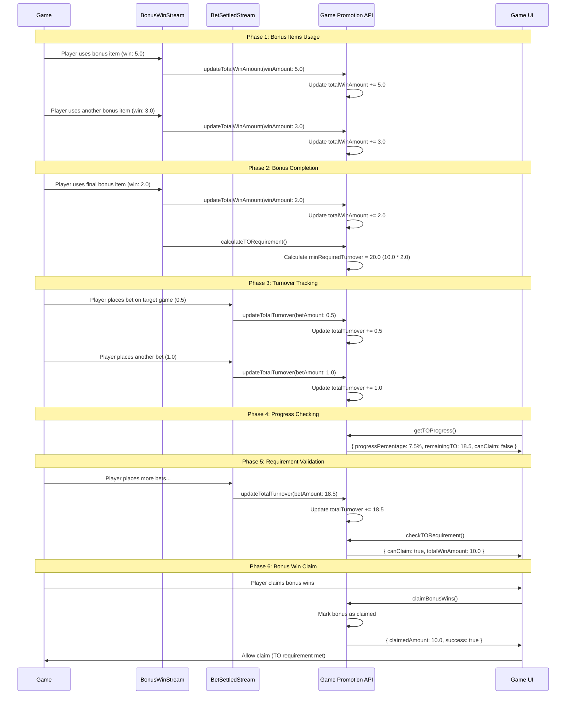

# Turnover Tracking Flow Sequence Diagram

This document shows the complete flow of the TO tracking system with all six APIs working together.

## Complete TO Tracking Flow

### Typical Usage Scenario

Here's how all six APIs work together in a complete TO tracking scenario:

## API Usage Patterns

### For Stream Consumers (Automated)

- `updateTotalWinAmount` - Called by BonusWinConsumer
- `updateTotalTurnover` - Called by TurnoverConsumer
- `calculateTORequirement` - Called by BonusWinConsumer when bonus completed

### For Game UI (Manual/On-Demand)

- `checkTORequirement` - Called before allowing bonus win claim
- `getTOProgress` - Called for UI progress display
- `claimBonusWins` - Called when player claims bonus wins

### For Monitoring/Debugging

- All APIs can be called manually for monitoring and debugging purposes
- Error responses provide detailed information for troubleshooting

## Flow Phases

### Phase 1: Bonus Items Usage

- Player uses bonus items (free spins)
- Each bonus win triggers `updateTotalWinAmount`
- Total win amount accumulates

### Phase 2: Bonus Completion

- When all bonus items are used (`remainingBonusItems: 0`)
- `calculateTORequirement` is called automatically
- Minimum required turnover is calculated

### Phase 3: Turnover Tracking

- Player places bets on target game
- Each bet settlement triggers `updateTotalTurnover`
- Total turnover accumulates

### Phase 4: Progress Checking

- UI calls `getTOProgress` to show current status
- Progress percentage and remaining TO are displayed

### Phase 5: Requirement Validation

- Player continues placing bets until TO requirement is met
- `checkTORequirement` validates if claiming is allowed

### Phase 6: Bonus Win Claim

- Player claims bonus wins via `claimBonusWins`
- Bonus is marked as claimed atomically
- Claimed amount is returned

## Key Features

- **Atomic Operations**: All updates are performed atomically
- **Real-time Updates**: TO progress updates in real-time
- **Security Protection**: Prevents exploitation when minRequiredTurnover = 0
- **Stream Integration**: Designed for stream consumer integration
- **Comprehensive Validation**: All conditions checked in MongoDB query
