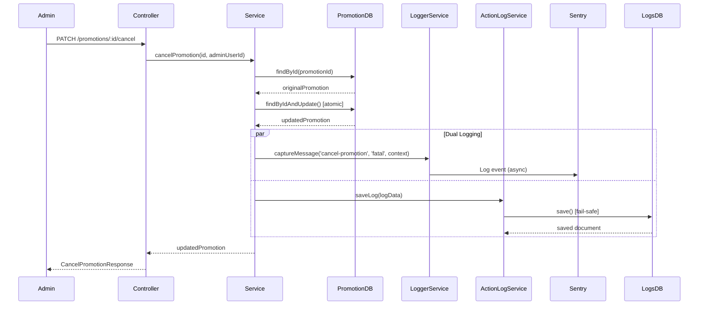

# Data Model: Promotion Cancellation Audit Logging

**Feature**: GL-5286-end-promotion  
**Date**: 2025-10-30  
**Purpose**: Define data structures for MongoDB audit logging of promotion cancellation events

---

## Overview

This document defines the data structures used for logging promotion cancellation events to MongoDB via ActionLogService. The logging strategy reuses the existing ActionLog schema with promotion-specific data in the flexible `request` and `response` fields.

**Key Design Decisions**:
1. **Reuse Existing Schema**: No new MongoDB collections or schemas required
2. **Flexible Structure**: `request` and `response` objects use `[key: string]: any` for extensibility
3. **Admin Action Pattern**: Use empty strings for `playerId` and `siteName` (admin actions don't have player context)
4. **Dual Logging**: Both Sentry (LoggerService) and MongoDB (ActionLogService) receive structured data

---

## 1. ActionLog Schema (Existing, Reused)

### 1.1 MongoDB Collection

**Collection Name**: `promotion_requests`  
**Connection**: `logs` (separate MongoDB connection for audit logs)  
**Location**: `src/core/action-log/schemas/action-log.schema.ts`

### 1.2 Schema Definition

```typescript
@Schema({ collection: 'promotion_requests', timestamps: true })
export class ActionLog extends Document {
  @Prop({ required: true, index: true })
  operatorId: string;

  @Prop({ required: true, index: true })
  logTimeStamp: string; // ISO 8601 format

  @Prop({ required: true, index: true })
  action: string;

  @Prop({ type: Object, required: true })
  request: {
    playerId: string;
    siteName: string;
    promotionId?: string;
    [key: string]: any; // Flexible for additional fields
  };

  @Prop({ type: Object })
  response?: {
    claimedAmount?: number;
    totalTurnover?: number;
    minRequiredTurnover?: number;
    totalWinAmount?: number;
    progressPercentage?: number;
    errorCode?: string;
    errorMessage?: string;
    errorDescription?: string;
    [key: string]: any; // Flexible for additional fields
  };
}
```

### 1.3 Mongoose Timestamps

**Auto-Generated Fields**:
- `createdAt`: Timestamp when document is created (Mongoose automatic)
- `updatedAt`: Timestamp when document is last updated (Mongoose automatic)

**Usage**: `{ timestamps: true }` in schema decorator enables automatic timestamp management.

### 1.4 Indices

**Existing Compound Indices** (defined in schema):
1. `{ operatorId: 1, logTimeStamp: -1 }` → Fast operator-specific queries, sorted by time
2. `{ 'request.playerId': 1, logTimeStamp: -1 }` → Player-specific log queries
3. `{ action: 1, logTimeStamp: -1 }` → Filter by action type, sorted by time
4. `{ 'response.errorCode': 1, logTimeStamp: -1 }` → Error log queries

**Query Patterns Supported**:
- ✅ Find all cancellations by operatorId: Use index #1
- ✅ Find all cancel-promotion actions: Use index #3
- ✅ Find all cancellations in date range: Use index #3 with time filter
- ⚠️ Find cancellation by promotionId: No dedicated index (acceptable for MVP, queries are infrequent)

---

## 2. Promotion Cancellation Log Structure

### 2.1 Complete Log Document

```typescript
{
  // Root-level required fields
  action: 'cancel-promotion',
  operatorId: string, // From promotion.operatorId
  logTimeStamp: string, // ISO 8601 timestamp (new Date().toISOString())
  
  // Request data (cancellation details)
  request: {
    playerId: '', // Empty string for admin actions
    siteName: '', // Empty string for admin actions
    promotionId: string, // promotion._id.toString()
    promotionCode: string, // promotion.code
    adminUserId: string, // Admin who performed cancellation
    originalEndDate: string, // ISO 8601 - scheduled end date before cancellation
    newEndDate: string, // ISO 8601 - actual end date (cancellation timestamp)
  },
  
  // Response data (operation result)
  response: {
    success: boolean, // true for successful cancellation
    code: string, // Error code (PR3103 for success)
    message: string, // Human-readable message
  },
  
  // Mongoose auto-generated timestamps
  createdAt: Date, // MongoDB creates this automatically
  updatedAt: Date, // MongoDB creates this automatically
}
```

### 2.2 Field-by-Field Reference

| Field | Type | Required | Description | Example Value |
|-------|------|----------|-------------|---------------|
| `action` | string | Yes | Action type identifier | `'cancel-promotion'` |
| `operatorId` | string | Yes | Operator identifier for filtering | `'op123'` |
| `logTimeStamp` | string | Yes | ISO 8601 timestamp | `'2025-10-30T14:30:00.000Z'` |
| `request.playerId` | string | Yes* | Player ID (empty for admin actions) | `''` |
| `request.siteName` | string | Yes* | Site name (empty for admin actions) | `''` |
| `request.promotionId` | string | No | Promotion ObjectId as string | `'507f1f77bcf86cd799439011'` |
| `request.promotionCode` | string | No | Human-readable promotion code | `'summer-promo-2025'` |
| `request.adminUserId` | string | No | Admin user identifier | `'admin123'` |
| `request.originalEndDate` | string | No | Original scheduled end date | `'2025-12-31T23:59:59.000Z'` |
| `request.newEndDate` | string | No | New end date (cancellation time) | `'2025-10-30T14:30:00.000Z'` |
| `response.success` | boolean | No | Operation success flag | `true` |
| `response.code` | string | No | Response code | `'PR3103'` |
| `response.message` | string | No | Human-readable message | `'Promotion has been successfully cancelled'` |

\* _Required by schema but can be empty string for admin actions_

### 2.3 Example: Successful Cancellation

```json
{
  "action": "cancel-promotion",
  "operatorId": "op123",
  "logTimeStamp": "2025-10-30T14:30:00.000Z",
  "request": {
    "playerId": "",
    "siteName": "",
    "promotionId": "507f1f77bcf86cd799439011",
    "promotionCode": "summer-promo-2025",
    "adminUserId": "admin123",
    "originalEndDate": "2025-12-31T23:59:59.000Z",
    "newEndDate": "2025-10-30T14:30:00.000Z"
  },
  "response": {
    "success": true,
    "code": "PR3103",
    "message": "Promotion has been successfully cancelled"
  },
  "createdAt": "2025-10-30T14:30:00.123Z",
  "updatedAt": "2025-10-30T14:30:00.123Z"
}
```

### 2.4 Example: Failed Cancellation (Promotion Not Found)

```json
{
  "action": "PROMOTION_CANCELLED_FAILED",
  "operatorId": "op123",
  "logTimeStamp": "2025-10-30T14:35:00.000Z",
  "request": {
    "playerId": "",
    "siteName": "",
    "promotionId": "invalid-id-12345",
    "promotionCode": "unknown",
    "adminUserId": "admin123",
    "originalEndDate": "",
    "newEndDate": ""
  },
  "response": {
    "success": false,
    "code": "PR3100",
    "message": "Promotion not found",
    "errorCode": "PR3100",
    "errorMessage": "Promotion with ID invalid-id-12345 not found"
  },
  "createdAt": "2025-10-30T14:35:00.456Z",
  "updatedAt": "2025-10-30T14:35:00.456Z"
}
```

**Note**: Error case logging is optional for MVP. Current implementation only logs successful cancellations. Error logging can be added in future enhancement.

---

## 3. Sentry Log Data Structure

### 3.1 LoggerService.captureMessage Payload

**Method Signature**:
```typescript
captureMessage(
  message: string,
  level: 'fatal' | 'critical' | 'error' | 'warning' | 'info' | 'debug',
  context?: Record<string, any>
): void
```

### 3.2 Cancellation Log Call

```typescript
this.logger.captureMessage(
  'cancel-promotion',
  'critical', // Elevated log level for admin actions
  {
    action: 'cancel-promotion',
    promotionId: promotion._id.toString(),
    promotionCode: promotion.code,
    adminUserId: cancelDto.adminUserId,
    timestamp: now.toISOString(),
    originalEndDate: originalEndDate.toISOString(),
    newEndDate: now.toISOString(),
    operatorId: promotion.operatorId,
  },
);
```

### 3.3 Sentry Event Structure

**Resulting Sentry Event**:
```json
{
  "message": "PROMOTION_CANCELLED",
  "level": "critical",
  "timestamp": "2025-10-30T14:30:00.000Z",
  "extra": {
    "action": "cancel-promotion",
    "promotionId": "507f1f77bcf86cd799439011",
    "promotionCode": "summer-promo-2025",
    "adminUserId": "admin123",
    "timestamp": "2025-10-30T14:30:00.000Z",
    "originalEndDate": "2025-12-31T23:59:59.000Z",
    "newEndDate": "2025-10-30T14:30:00.000Z",
    "operatorId": "op123"
  },
  "tags": {
    "environment": "production",
    "server_name": "game-promotion-api"
  }
}
```

---

## 4. Query Patterns

### 4.1 Query by Promotion ID

**Use Case**: Find cancellation log for a specific promotion

**MongoDB Query**:
```javascript
db.promotion_requests.find({
  action: 'cancel-promotion',
  'request.promotionId': '507f1f77bcf86cd799439011'
}).sort({ logTimeStamp: -1 }).limit(1)
```

**Expected Result**: Single document (most recent if multiple cancellations exist)

**Performance**: ⚠️ No dedicated index on `request.promotionId` - acceptable for infrequent queries

### 4.2 Query by Operator ID

**Use Case**: Find all cancellations for a specific operator

**MongoDB Query**:
```javascript
db.promotion_requests.find({
  action: 'cancel-promotion',
  operatorId: 'op123'
}).sort({ logTimeStamp: -1 }).limit(100)
```

**Index Used**: `{ operatorId: 1, logTimeStamp: -1 }` - **Efficient ✅**

### 4.3 Query by Admin User

**Use Case**: Audit log for specific admin's cancellation actions

**MongoDB Query**:
```javascript
db.promotion_requests.find({
  action: 'cancel-promotion',
  'request.adminUserId': 'admin123'
}).sort({ logTimeStamp: -1 }).limit(100)
```

**Performance**: ⚠️ No dedicated index on `request.adminUserId` - acceptable for admin audit queries (infrequent)

### 4.4 Query by Date Range

**Use Case**: Compliance report for cancellations in a specific period

**MongoDB Query**:
```javascript
db.promotion_requests.find({
  action: 'cancel-promotion',
  logTimeStamp: {
    $gte: '2025-10-01T00:00:00.000Z',
    $lte: '2025-10-31T23:59:59.999Z'
  }
}).sort({ logTimeStamp: -1 })
```

**Index Used**: `{ action: 1, logTimeStamp: -1 }` - **Efficient ✅**

### 4.5 Query All Cancellations

**Use Case**: Admin dashboard showing all promotion cancellations

**MongoDB Query**:
```javascript
db.promotion_requests.find({
  action: 'cancel-promotion'
}).sort({ logTimeStamp: -1 }).limit(100)
```

**Index Used**: `{ action: 1, logTimeStamp: -1 }` - **Efficient ✅**

### 4.6 ActionLogService Query Methods

**Available Methods** (from `src/core/action-log/services/action-log.service.ts`):

```typescript
// Query by operator
getLogsByOperator(operatorId: string, limit = 100, skip = 0): Promise<ActionLog[]>

// Query by player (not applicable for cancellations)
getLogsByPlayer(playerId: string, limit = 100, skip = 0): Promise<ActionLog[]>

// Query by action type
getLogsByAction(action: string, limit = 100, skip = 0): Promise<ActionLog[]>

// Query error logs
getErrorLogs(limit = 100, skip = 0): Promise<ActionLog[]>

// Query by date range
getLogsByDateRange(startDate: string, endDate: string, limit = 100, skip = 0): Promise<ActionLog[]>
```

**Usage Example** (in application code):
```typescript
// Find all cancellations
const cancellations = await actionLogService.getLogsByAction('cancel-promotion', 50, 0);

// Find cancellations by operator
const opCancellations = await actionLogService.getLogsByOperator('op123', 100, 0);

// Find cancellations in date range
const octCancellations = await actionLogService.getLogsByDateRange(
  '2025-10-01T00:00:00.000Z',
  '2025-10-31T23:59:59.999Z',
  100,
  0
);
```

---

## 5. Data Flow

### 5.1 Cancellation to Audit Log Flow

```
1. Admin → PATCH /promotions/:id/cancel
          ↓
2. PromotionController.cancelPromotion()
          ↓
3. PromotionService.cancelPromotion()
          ↓
4. MongoDB Update (promotion document)
          ↓ (success)
5. LoggerService.captureMessage() → Sentry
          ↓ (parallel)
6. ActionLogService.saveLog() → MongoDB action_logs
          ↓
7. Return CancelPromotionResponse to Admin
```

### 5.2 Logging Sequence Diagram



### 5.3 Error Handling Flow

```
MongoDB Logs DB Unavailable
          ↓
ActionLogService.saveLog() throws
          ↓
ActionLogService catches error internally
          ↓
console.error('Failed to save action log...')
          ↓
ActionLogService.saveLog() returns null
          ↓
PromotionService continues (no exception)
          ↓
Sentry log still succeeds (fallback)
          ↓
Admin receives successful response
```

---

## 6. Data Retention & Cleanup

### 6.1 Current Policy

**Retention**: Unlimited (no automatic cleanup)  
**Cleanup Method**: Manual via `ActionLogService.deleteOldLogs(daysToKeep: number)`

### 6.2 Manual Cleanup Example

```typescript
// Delete logs older than 90 days
const deletedCount = await actionLogService.deleteOldLogs(90);
console.log(`Deleted ${deletedCount} old action logs`);
```

**MongoDB Query** (executed by deleteOldLogs):
```javascript
const cutoffDate = new Date();
cutoffDate.setDate(cutoffDate.getDate() - 90);

db.promotion_requests.deleteMany({
  logTimeStamp: { $lt: cutoffDate.toISOString() }
})
```

### 6.3 Recommended Retention Policy

**For Compliance**:
- Financial audit logs: 7 years (industry standard)
- Administrative actions: 3-5 years
- Player actions: 1-2 years

**Implementation Options** (future enhancement):
1. **Scheduled Cleanup Job**: Cron job calling `deleteOldLogs()`
2. **MongoDB TTL Index**: Automatic deletion based on `createdAt` field
3. **External Archival**: Move old logs to cold storage (S3, Glacier)

---

## 7. Testing Data

### 7.1 Mock Data for Unit Tests

```typescript
const mockCancellationLog: IActionLog = {
  action: 'cancel-promotion',
  operatorId: 'op123',
  logTimeStamp: '2025-10-30T14:30:00.000Z',
  request: {
    playerId: '',
    siteName: '',
    promotionId: '507f1f77bcf86cd799439011',
    promotionCode: 'summer-promo-2025',
    adminUserId: 'admin123',
    originalEndDate: '2025-12-31T23:59:59.000Z',
    newEndDate: '2025-10-30T14:30:00.000Z',
  },
  response: {
    success: true,
    code: 'PR3103',
    message: 'Promotion has been successfully cancelled',
  },
};
```

### 7.2 Integration Test Verification

**Assertion Example**:
```typescript
// After cancellation, query MongoDB
const logs = await actionLogService.getLogsByAction('cancel-promotion');

expect(logs).toHaveLength(1);
expect(logs[0].request.promotionId).toBe('507f1f77bcf86cd799439011');
expect(logs[0].request.adminUserId).toBe('admin123');
expect(logs[0].response.code).toBe('PR3103');
```

---

## 8. Schema Evolution (Future Considerations)

### 8.1 Potential Schema Enhancements

**Option 1: Add adminUserId to Root Level**
```typescript
@Schema({ collection: 'promotion_requests', timestamps: true })
export class ActionLog extends Document {
  // ... existing fields
  
  @Prop({ index: true }) // Make optional for backward compatibility
  adminUserId?: string; // Admin user for administrative actions
}
```

**Benefit**: Dedicated index for admin audit queries  
**Trade-off**: Requires schema migration for existing documents

**Option 2: Add Cancellation-Specific Index**
```typescript
ActionLogSchema.index({ 
  'request.promotionId': 1, 
  logTimeStamp: -1 
}); // Optimize promotion-specific queries
```

**Benefit**: Faster queries by promotionId  
**Trade-off**: Increased write overhead, larger index size

**Option 3: Separate ActionLog Types**
```typescript
@Schema({ discriminatorKey: 'actionType' })
export class ActionLog extends Document {
  // Base fields
}

@Schema()
export class AdminActionLog extends ActionLog {
  adminUserId: string;
  // Admin-specific fields
}

@Schema()
export class PlayerActionLog extends ActionLog {
  playerId: string;
  siteName: string;
  // Player-specific fields
}
```

**Benefit**: Type-safe, dedicated fields for each action type  
**Trade-off**: Significant complexity, requires refactoring

**Recommendation**: Keep current schema for MVP. Evaluate enhancements based on usage patterns after 3-6 months.

---

## Summary

**Data Model Status**: ✅ Complete and ready for implementation

**Key Takeaways**:
1. Reuses existing ActionLog schema (no migrations required)
2. Flexible structure supports all cancellation audit requirements
3. Query patterns leverage existing indices (performant)
4. Fail-safe design ensures business operation continuity
5. Dual logging (Sentry + MongoDB) provides redundancy
6. Clear field mappings and examples for implementation

**Next Steps**:
1. Review quickstart.md for implementation guide
2. Update tasks.md with specific implementation tasks
3. Begin implementation following defined data structures
